# QGenie Remote: architecture

| | |
| --- | --- |
| Status | Draft v0.8, for review (TUI-only MVP; gateway-admin revocation within 10 s; Entra disablement within 15 min; revocation preserves host sessions; corporate network/VPN gateway access) |
| Date | 2026-10-15 |
| Related | [PRD](PRD.md) |

Diagrams use Mermaid (rendered by GitHub/GitLab). The system overview is also drawn in ASCII, so it can be read in a terminal.

**First-release scope:** the client is the Rust TUI. Electron, the TS SDK, desktop hosting prompts, and tray controls shown below are later integrations and are not MVP dependencies. Host enrollment uses `qgenie remote up`.

**Network scope:** hosts and clients reach `qgenie-remote.qualcomm.com` through the corporate network or a corporate VPN. The gateway need not be exposed to the public internet. Clients do not need direct network access to enrolled hosts.

**Implementation contracts:** [The decision records](docs/adr/README.md) refine this draft's illustrative flows. They define durable authority, independent service lifetime, full-width counters, fencing, recording receipts, and deployment behavior. [The operation matrix](docs/contracts/operation-matrix.md) defines action requirements. These contracts do not establish native-agent, tenant, platform, or scale proof.

## 1. System overview

```text
CLIENTS                                     QGENIE REMOTE (server side)                                                 HOSTS
                                                                                                                    (laptops, servers)

┌─────────────────────────┐                 ┌─────────────────────────────────────────────────────────────┐
│ qgenie TUI (Rust)       │                 │ L7 load balancer (TLS, WSS, :443)                           │
│ `qgenie remote`         │────┐            └─────────────────────────────────────────────────────────────┘         ┌────────────────────────────────────┐
│                         │    │                        │                                    │                      │ qgenie remote host (Rust)          │
└─────────────────────────┘    │  WSS + REST            │                                    │                      │ connector: 1 outbound WSS          │
                               ├───────────────────────▶│                                    │◀─────────────────────│ auth, routing, policy              │
                               │                        ▼                                    ▼               WSS    └────────────────────────────────────┘
┌─────────────────────────┐    │            ┌────────────────────────┐          ┌────────────────────────┐                             │
│ Desktop app             │    │            │ gateway node 1         │          │ gateway node N         │                             │  Unix socket /
│ (Electron, TS SDK)      │────┤            │                        │          │                        │                             │  named pipe
│                         │    │            │  ┌──────────────────┐  │          │ (identical,            │                             ▼
└─────────────────────────┘    │            │  │ conn mgr         │  │          │ stateless)             │          ┌────────────────────────────────────┐
                               │            │  │ authz            │  │          │                        │          │ qgenie remote sessiond             │
                               │            │  │ router           │  │          │                        │          │ owns sessions + replay logs        │
┌─────────────────────────┐    │            │  │ control API      │  │          │                        │          │                                    │
│ Web (later)             │────┘            │  │                  │  │          │                        │          │                                    │
└─────────────────────────┘                 │  └──────────────────┘  │          │                        │          │                                    │
                                            │                        │          │                        │          │ ┌──────┐  ┌───────┐  ┌───┐  ┌────┐ │
                                            └────────────────────────┘          └────────────────────────┘          │ │codex │  │claude │  │pi │  │pty │ │
                                                │          │     │                    │      │      │               │ │      │  │       │  │   │  │    │ │
                                                │          │     │                    │      │      │               │ └──────┘  └───────┘  └───┘  └────┘ │
                                                │          │     │                    │      │      │               │     │         │        │       │   │
                               ┌────────────────┘          │     │                    │      │      │               └─────┼─────────┼────────┼───────┼───┘
                               │                           │     └──────────────────┐ │      │      │                     │         │        │       │
                               │                           │                        │ │      │      │                     ▼         ▼        ▼       ▼
                               ▼                           ▼                        ▼ ▼      ▼      ▼
                    ┌─────────────────────┐     ┌─────────────────────┐        ┌──────────────────────────┐          codex app-  claude     pi    shell
                    │ PostgreSQL          │     │ Redis (latest)      │        │ Audit/OTel               │          server        -p       rpc   /bin/zsh
                    │ users,machines      │     │ pub/sub bus +       │        │ pipeline                 │          daemon      stream
                    │ sessions,           │     │ presence (TTL)      │        │ aiplatforms-otel         │
                    │ approvals,          │     └─────────────────────┘        └──────────────────────────┘
                    │ audit index,        │                                                                        (all launched with QGenie
                    │ transcripts         │                                                                         endpoint injection)
                    │ (90 d, holds)       │
                    │                     │
                    │                     │
                    └─────────────────────┘

               ┌─────────────────────────────┐
               │ Entra ID (QGenie OAuth)     │◀── users sign in (PKCE / device code); gateway validates JWTs (JWKS)
               └─────────────────────────────┘
```

**QGenie Remote (on-prem, Docker Compose)**

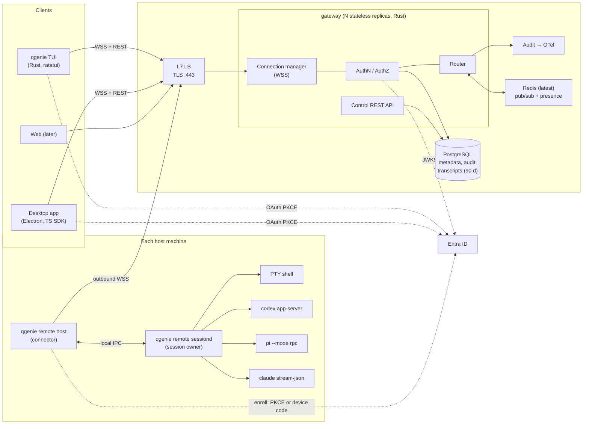

**Core idea:** the gateway authenticates connections, authorizes each message, and moves frames between clients and hosts. It does not run agents or keep session buffers. Hosts are the source of truth for session content, including output replay. Postgres is the source of truth for identity, machines, and session metadata. Transcripts are also written to Postgres for history and audit (§4.4); that copy is never used for live replay. This keeps the gateway stateless, so it scales horizontally and survives restarts without losing sessions.

Session names and labels have one durable authority: the gateway-owned metadata
column in PostgreSQL. Native host projections cannot replace that column. Names
are scoped aliases; session IDs identify native lifetimes and recordings. Client
launch profiles only save choices and reuse the existing authorized start path.


## 2. Key decisions

| # | Decision | Choice | Main alternative |
| --- | --- | --- | --- |
| D1 | Gateway language | Rust (see §3) | Go |
| D2 | Transport | One multiplexed WebSocket over TLS per connection, our own framing | gRPC bidi streaming; Socket.IO; yamux-in-WS |
| D3 | Message model | Typed operations (`session.start`, input, approve…), not a generic TCP/HTTP tunnel | Tunnel local agent APIs (omg.dev style) |
| D4 | Encoding | JSON text frames for control/events; binary frames for PTY bytes | Protobuf/CBOR everywhere |
| D5 | Trust boundary | TLS terminates at the gateway; the gateway may inspect for authz and audit | Application-layer E2EE (Happy-style) |
| D6 | Cross-node routing | Redis (latest stable, ≥ 7) sharded pub/sub channels per machine, session, and user; presence as Redis keys with TTL | NATS; sticky routing + node-to-node gRPC |
| D7 | Host process model | Two processes in one binary: `host` (network) + `sessiond` (owns sessions) | Single daemon process |
| D8 | Host identity | Ed25519 key per machine + short-lived machine tokens | Reuse the user's OAuth refresh token |
| D9 | Replay | Host-side per-session event log with sequence numbers | Gateway-side buffering (Redis Streams) |
| D10 | Agent integration | Native protocols (Codex app-server, Claude stream-json, Pi RPC); PTY as fallback | Screen-scraping every agent through a PTY |
| D11 | Client SDK | Protocol defined as Rust types → JSON Schema → generated TS. Rust client crate for the TUI; `@qgenie/remote-sdk` (TS) for Electron | Handwritten SDKs per client; Rust addon via napi-rs |
| D12 | Headless login | Device authorization grant when no browser is available (SSH session, no display); PKCE loopback otherwise | Enrollment codes created from a signed-in client (deferred) |
| D13 | Transcript history | Recording is always enabled: structured agent transcripts and terminal (PTY) output, stored in Postgres (monthly partitions), using a 90-day cutoff rounded to about 120 days unless under legal hold. Sessions continue during recording failures; missing content is marked and alerted | Object storage (S3) chunks; agent transcripts only |
| D14 | Transcript access | Only the owning user and platform admins can read a transcript, enforced by Postgres row-level security and the API. Every admin read is audited | Broader security/manager roles |
| D15 | Codex built-in remote control | Loopback/local IPC only. QGenie managed config disables Codex's own relay; our daemon reaches Codex over its Unix socket or `ws://127.0.0.1` | Allow Codex's relay alongside ours |
| D16 | Laptop hosting | Laptops are hosts once `qgenie remote up` has run. Users run it themselves in the TUI-only MVP; desktop enrollment and supervision follow later | Laptops as clients only |
| D17 | Deployment | v1: one deployment, on-prem servers, Docker Compose. Redis and Postgres run as containers in the same deployment. Images stay orchestrator-neutral (no Kubernetes APIs), so Kubernetes or more sites can be added later without code changes | Kubernetes now; multiple sites now |
| D18 | Sessions started outside QGenie Remote | Adopt them when they run as the same OS user as the host daemon: discovered through each agent's own session registry, controlled where the agent allows it, otherwise observe-only | Only show sessions that QGenie Remote started |

Reasons for the less obvious choices:

- **D2/D4:** WebSockets go through corporate proxies and browsers, and the desktop app can use them natively. gRPC bidi streaming is awkward through HTTP/1.1 proxies and in browsers. JSON is easy to debug and to consume from TS. Only terminal bytes need to be compact, so they use binary frames.
- **D3:** typed operations let the gateway authorize each action (for example, an observer can't send input), audit approvals, and enforce policy. A generic tunnel would hide all of that and expose local agent ports.
- **D5:** QGenie already sees prompts at its inference endpoint. Enterprises need audit, and E2EE adds key management for pairing, recovery and sharing. Host-side policy (PO-1) still limits the damage if the gateway is compromised.
- **D6:** with a shared bus, any client can connect to any gateway node. That node publishes to `host:{machine_id}`, and the node holding that host's connection delivers it. There is no sticky routing and no node discovery. Redis pub/sub only delivers each message at most once, and that's acceptable: durability lives on the host (D9), and lost frames are recovered by sequence-number replay. Details are in §4.3.
- **D12:** the existing PKCE login needs a browser that can reach a localhost callback on the same machine. Over SSH to a lab server that fails, so device code is needed for exactly the hosts that matter most. The CLI picks it automatically when `SSH_CONNECTION` is set or no display is available, or when `--device-code` is passed.
- **D13/D14:** see §4.4. Postgres is enough for this volume of data (compressed JSONB events, monthly partitions), and it gives us transactions, row-level security, and legal-hold queries without another storage system.
- **D15:** see §4.7. We want a single, audited path into every machine. A second relay run by a vendor would bypass QGenie authorization, policy, and audit.
- **D16:** see §4.5. "Host by default" applies only after an explicit enrollment, so a machine is never exposed without the user knowing.
- **D17:** see §9. Leader election, presence, routing and configuration already go through Redis, Postgres and environment variables, so nothing in the gateway depends on the orchestrator. Starting with one Compose deployment keeps operations simple. Kubernetes and additional sites are deferred, not designed out.
- **D18:** see §4.8. Users already run agents in their own terminals, tmux and Herdr. Showing only the sessions we started would hide most of their real work.
- **D7:** network disconnects, token refreshes, and connector upgrades must not kill running agents. `sessiond` owns PTYs and agent children in an independent service-manager lifetime. [ADR 0003](docs/adr/0003-session-lifetime-and-ipc.md) requires separate systemd units/cgroups and launchd jobs. `setsid` alone does not establish this behavior. Defer sessiond updates while sessions are active unless a local user explicitly accepts disruption.
- **D8:** if a laptop's keyring leaks a machine key, only that machine is compromised, and it can be revoked on its own. User refresh tokens never sit on long-running servers.

## 3. Gateway language: Rust vs Go

Both would work. The gateway's work is long-lived WebSocket connections, auth, and forwarding frames, and both languages handle this well at our scale (up to ~200k connections across the deployment, §9.7).

| Factor | Rust | Go |
| --- | --- | --- |
| Sharing code with the CLI | ✅ One `qgenie-remote-proto` crate: message types, validation, version negotiation, signing. Host, TUI, and gateway can't drift. | ❌ Protocol duplicated in Go. Needs a schema-first toolchain (JSON Schema/protobuf codegen) to stay in sync. |
| Team skills | ✅ The CLI team already writes Rust (`tokio`, `axum`, `reqwest`, `ratatui`, `keyring` are in qgenie 1.1.25). | ⚠ Need Go skills or a separate team. |
| Speed of building a network server | ⚠ Slower to write; async lifetimes, `Send` bounds, and backpressure take care. | ✅ Goroutines per connection, a simpler mental model, very fast to iterate. |
| Ecosystem for this server | ✅ `axum`/`hyper`, `tokio-tungstenite`, `fred` (Redis), `sqlx`, `jsonwebtoken`, `opentelemetry`. All mature. | ✅ Slightly richer: `coder/websocket`, `go-redis`, `pgx`, and many reference implementations (Multica, ShellHub, Coder). |
| Runtime behavior | ✅ No GC pauses; predictable memory per connection; good for p99 keystroke latency. | ✅ GC pauses are small in practice; slightly higher memory per connection. |
| Operations | ✅ Static binary, small container. | ✅ Same, plus mature pprof tooling. |
| Hiring/maintenance | ⚠ Fewer backend Rust engineers. | ✅ Common for infra/backend. |

**Recommendation: Rust.** Go is easier for the gateway in isolation. But the system's correctness lives in the protocol: sequence numbers, idempotency, control leases, approval state machines, and version negotiation. That protocol must behave the same in the host daemon, the TUI client, and the gateway, and two of those three are already Rust. One shared crate removes a whole class of bugs. The gateway itself is a small part of the codebase (routing + auth + a REST API), so Rust's extra development cost is modest.

The Electron desktop app doesn't change this. It consumes generated TS types either way, and with Rust they come from the same crate that the host and TUI use.

Choose Go instead if a separate backend team that works mainly in Go will own the gateway. In that case, make the protocol schema-first (JSON Schema in the repo, generating Rust, Go, and TS types) and run a cross-language conformance test suite in CI.

## 4. Components

### 4.1 Host side (inside the `qgenie` binary)

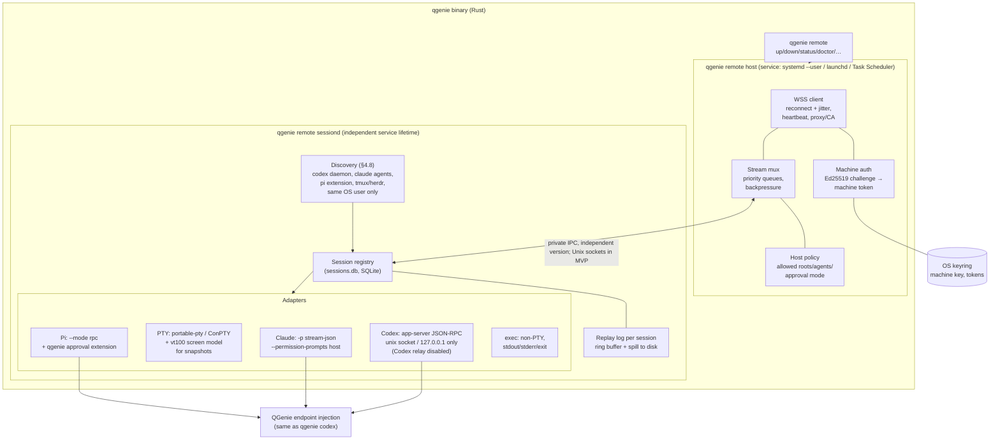

| Component | Responsibility |
| --- | --- |
| `qgenie remote up` | Signs in with OAuth (reusing the CLI's existing PKCE and keyring code, plus a new scope), generates the machine key, enrolls, and installs/starts the service (reusing the existing systemd/launchd/Task Scheduler/WinSW installer used by `qgenie proxy service`). |
| `host` (connector) | Keeps one outbound WSS connection to the gateway. Machine authentication, heartbeats, reconnect with exponential backoff and jitter. Enforces host policy on every incoming request: roots for browsing/new-session cwd/file transfer, allowed agents, terminal policy, and approval mode. An existing same-user session's outside-root cwd does not block its supported control operations (§4.8). Forwards authorized operations to `sessiond`. Reports inventory (agents and versions) and presence. |
| `sessiond` | Owns sessions and child processes. Persists the registry, replay, approval state, and recording spool. Adapters normalize native protocols. The service integration starts it on demand in an independent unit/job. Connector stop does not propagate. Idle exit requires no active sessions or pending durable work. |
| Discovery | Finds agent and terminal sessions that the same OS user started outside QGenie Remote and registers them as adopted sessions with control or observe capability (§4.8). |
| Adapters | **Codex:** connects to the local `codex app-server daemon` over its Unix socket (or `ws://127.0.0.1`), or starts it; Codex's own remote-control relay stays disabled (§4.7). Uses JSON-RPC thread/turn/steer/interrupt, items, and approvals. Schemas are generated from the installed Codex version. **Claude:** a long-lived `claude -p --input-format stream-json --output-format stream-json --permission-prompts host` process per session. **Pi:** `pi --mode rpc`, plus a small QGenie extension whose `tool_call` hook turns confirmations into approvals. **PTY:** for shells or any CLI. Keeps a vt100 screen model so reattach sends a snapshot, then live bytes. |

### 4.2 Gateway (Rust service, N replicas)

| Module | Responsibility |
| --- | --- |
| Edge/conn manager | Accepts WSS on `/v1/connect/host` and `/v1/connect/client`, ping/pong, limits on frame size and rate, per-connection bounded send queues (drops/marks slow observers instead of blocking the session). |
| AuthN | Clients: Entra JWT (audience `qgenie-remote`) on the WS upgrade (`Authorization` header for TUI/desktop; short-lived connect ticket from REST for browsers). Hosts: machine token issued after an Ed25519 challenge. Re-checks on token expiry and checks durable gateway revocation state on new connections. Existing connections use push invalidation plus bounded authoritative reconciliation (§8); token expiry is not the revocation fallback. |
| AuthZ | Policy engine per message: is this user the owner (or, in v2, a sharee with a role) of this machine/session? Does this operation require the control lease? Approval answers require the owning user and host policy, but not a control lease. Is the org feature enabled? Gateway revocation state is cached for at most 5 s and invalidated through Redis pub/sub; stale authority cannot permit continued remote access (§8). |
| Router | Publishes client→host frames to `host:{machine_id}` and host→client frames to `sess:{session_id}` / `conn:{conn_id}` (Redis `SPUBLISH`). Subscribes (`SSUBSCRIBE`) only for connections attached to this node. Fan-out to observers happens at the subscribing nodes. |
| Session/approval state | Writes metadata, durable control generations, and approval records to Postgres. One conditional transaction commits an approval winner, audit event, and outbox obligation. Native application has a separate acknowledged or uncertain outcome under ADR 0002. |
| Control REST API | `/v1/machines`, `/v1/enrollments`, `/v1/sessions` (list/history), `/v1/sessions/{id}/transcript` (owner or admin), `/v1/connect-tickets`, `/v1/admin/*` (kill switch, policy, legal holds), `/v1/audit` (admin). |
| Admin revocation (MVP) | `POST /v1/admin/revocations` at `qgenie-remote.qualcomm.com`, restricted to platform admins. Targets global access, a user, or a machine. Commits the disable state and audit event in Postgres, immediately denies access at the accepting node, pushes invalidation, and reports propagation status. All gateways enforce the change within 10 s (§8). Host sessions continue; revocation sends no termination command. No desktop app or admin UI is required. |
| Audit | Emits structured audit events (who/what/where/decision) to an append-only Postgres table + OTel logs. |
| Transcript writer | Ingests immutable batches from the independent host recording spool. Returns a receipt only after the content/gap and receipt ledger commit. Recording failure does not block live output. Replay is not the authoritative recording backlog. |
| Presence sweeper | One leader at a time (Redis lock `SET NX PX`). Marks machines offline when their presence key expires, e.g. after a gateway node crash. |
| Retention job | Runs nightly with PostgreSQL lifecycle coordination. Drops an entirely expired partition only after preserving all active hold coverage and references (§4.4; ADR 0005). |

### 4.3 Redis usage

Redis is a fast, disposable bus, never a source of truth. Every key can be rebuilt from Postgres plus reconnecting hosts.

| Purpose | Redis primitive | Key / channel | Notes |
| --- | --- | --- | --- |
| Client → host routing | Sharded pub/sub | `host:{machine_id}` | Subscribed only by the node holding that host's socket. |
| Host → viewers | Sharded pub/sub | `sess:{session_id}` | Subscribed by each node with ≥1 attached viewer; that node fans out locally. |
| Replies to one connection | Sharded pub/sub | `conn:{conn_id}` | Request/response such as `fs.list` or a `session.start` ack. |
| User-wide events | Sharded pub/sub | `user:{user_id}` | Presence changes, session list changes, approval badges. |
| Revocations / policy changes | Classic pub/sub (all nodes) | `revocations`, `policy` | Fast invalidation hints. Durable disable state lives in Postgres; gateway reconciliation recovers missed revocation messages within the 10 s bound (§8). |
| Presence | Key with TTL | `presence:{machine_id}` → `{node, conn_id, since}` EX 30 | Refreshed on each heartbeat (20 s). Expiry means offline. |
| Replace-older-connection | Key + pub/sub | `presence:{machine_id}` (`SET … GET`) | New host connection finds the old `conn_id` and tells that node to close it (4409). |
| Control lease cache | Key with TTL | `lease:{session_id}` → holder/generation projection | PostgreSQL allocates authority; sessiond activates and fences it. Redis TTL does not grant control. |
| Rate limits | Counters | `rl:{user}:{bucket}` | Per-user and per-machine message/byte budgets. |
| Sweeper leadership | Lock | `lock:presence-sweeper` | `SET NX PX`, renewed by leader. |

Semantics and limits to design around:

- **At-most-once delivery.** Pub/sub can drop messages. Session output uses cursors and periodic host-head reconciliation, including idle tail loss. An uncertain start uses same-key lookup. Committed approval delivery uses its durable decision ID. Input is never resent automatically. A generic transport retry loop does not establish these guarantees.
- **Backpressure.** Set `client-output-buffer-limit pubsub` with headroom, and coalesce PTY output on the host (≤16 ms or 32 KB batches). Slow observers are dropped and resync; they never slow down the session's controller.
- **Topology.** Use the latest stable Redis, starting with Sentinel (primary plus replica, in the single on-prem deployment). Sharded pub/sub needs Redis 7 or later, so any current release works. Pin the major version (image tag) in the Compose files and test upgrades in staging. Move to Redis Cluster when pub/sub throughput needs it. Sharded pub/sub (`SPUBLISH` / `SSUBSCRIBE`) only sends each message to the shard that owns the channel, so it scales across shards.
- **Failure.** If Redis is unavailable, gateway nodes keep serving clients and hosts that are on the same node, and return retryable errors for cross-node traffic. A Redis failover looks like a short gap that sequence-number resync repairs. Presence keys are rewritten on the next heartbeat.
- **User affinity (P0, needed at our scale):** hosts and clients send a routing hint, `X-QGR-Affinity: <hash(owner_user_id)>`, on the WebSocket upgrade. HAProxy uses consistent hashing on that header, so a user's machines and clients normally land on the same gateway container. The gateway then delivers locally and skips Redis. Redis carries only the traffic that crosses containers: during rebalancing after a container restart, in admin views, and later for shared machines. The hint is only for routing; authorization never relies on it.

### 4.4 Session recording and transcript history (Postgres, 90 days, legal hold)

What recording captures (always enabled, cannot be disabled by users or orgs; gaps are permitted during storage failures):

| Session kind | Recorded content | Format |
| --- | --- | --- |
| Agent (Codex, Claude, Pi) | Normalized events: prompts, assistant messages, reasoning summaries, tool calls and their output, diffs, approvals and who answered | zstd-compressed JSONL of `session.event` |
| Terminal (PTY) | All output bytes, plus resizes, timestamps, and the session's command and cwd. Input is recorded as the output echo only: raw keystrokes are not stored separately, so text typed at no-echo prompts (passwords) is not captured | zstd-compressed asciicast-v2-style stream (`[t, "o", data]`, `[t, "r", "120x40"]`) |
| `exec` | Command, cwd, stdout, stderr, exit code | same as PTY, separate streams |
| Adopted sessions (§4.8) | Same as above from the moment they are adopted, plus a backfill of earlier history from the agent's own log (within the retention window) | same |

- **Users are told:** the TUI, later desktop app and `qgenie remote up` state that recording is always enabled. Enrollment also discloses automatic discovery/recording of same-user external sessions and backfill from their available history. The default cutoff is 90 days, and monthly purging may retain content for about 120 days; legal holds can keep it longer. Terminal panes show a small "recorded" indicator, or a recording warning when there are gaps.
- **Sessions continue:** recording is always enabled, but recording failure never pauses or terminates a session. The host has a durable, disk-capped recording spool separate from the bounded live replay log. It retains unacknowledged content until Postgres commit is acknowledged or the spool cap is reached. Catch-up can use retained spool data and available replay history.
- **At the spool cap:** reclaim the oldest unacknowledged recording content to admit recent content. Track discarded sequence ranges and their reason in coalesced, durable gap metadata with reserved space. Show a recording warning in the TUI and alert operators; if the gateway is unreachable, report the warning locally and forward the gap markers and alert after reconnect. Session output and control continue. Missing content is never represented as a complete recording. Resume normal recording as storage recovers, while preserving earlier gap markers.
- **Volume guard:** per-session output above a configurable rate (default 2 MB/s sustained, e.g. a runaway `cat` of a binary) is compressed in larger batches and counted against a per-user quota that alerts operators. The spool-cap policy still applies. Content loss is always marked; users and orgs cannot deliberately disable recording.

Storage (Postgres):

The SQL below illustrates content fields. It is not a migration. [ADR 0005](docs/adr/0005-recording-and-retention.md) additionally requires immutable chunk identity, a unique receipt ledger, explicit held-table RLS, and hold coverage. Use full-u64-safe counter storage from ADR 0004.

```sql
-- one row per batch of events or terminal output (typically ≤ 64 KB compressed), monthly partitions
CREATE TABLE transcript_chunk (
  session_id uuid        NOT NULL,
  owner_id   uuid        NOT NULL,         -- denormalized for RLS
  seq_from   numeric(20,0) NOT NULL,       -- validate the full unsigned 64-bit range
  seq_to     numeric(20,0) NOT NULL,
  stream     text        NOT NULL,         -- 'events' | 'pty' | 'stdout' | 'stderr'
  events     bytea       NOT NULL,         -- zstd-compressed JSONL / asciicast lines
  created_at timestamptz NOT NULL,         -- validated batch capture time, stable on retries/backfill
  PRIMARY KEY (created_at, session_id, seq_from)
) PARTITION BY RANGE (created_at);

CREATE TABLE transcript_chunk_held (LIKE transcript_chunk INCLUDING ALL); -- not partitioned, never auto-purged

CREATE TABLE legal_hold (
  id uuid PRIMARY KEY, subject_user uuid NOT NULL, -- a hold covers a person (select individuals)
  from_ts timestamptz, to_ts timestamptz,          -- optional time window
  case_ref text NOT NULL, created_by uuid NOT NULL, created_at timestamptz NOT NULL,
  released_by uuid, released_at timestamptz
);
```

- The writer ingests host-spooled immutable batches, targeting 2 seconds or 64 KiB compressed per batch. It commits content and a stable receipt together. [ADR 0005](docs/adr/0005-recording-and-retention.md) defines capture time, bounded decompression, gaps, receipts, and database-recovery limits. Replay is independent.
- To keep the main database's I/O separate, transcripts can live in their own Postgres database or cluster behind the same code. That's a deployment choice, not a design change.
- Search across transcripts is P2. If needed, add a `tsvector` column over the extracted text.

Retention (90 days default):

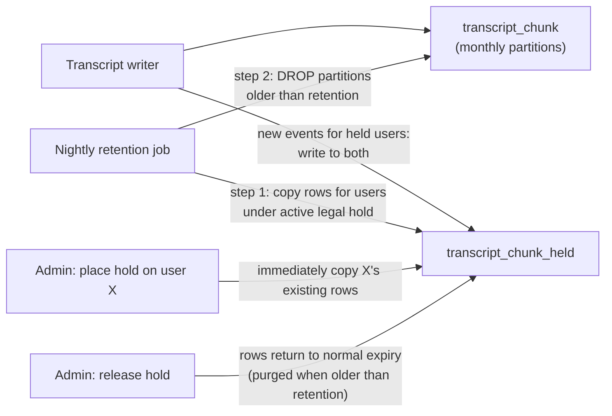

- The default retention cutoff is 90 days, configurable per org. A nightly job drops a monthly partition only when its entire time range is older than that cutoff. The oldest rows can therefore remain for roughly an additional calendar month plus the job interval, about 120 days at the default. This rounding is an accepted product decision, and users are told about it. Dropping a whole partition is cheap and leaves no bloat.
- Partition time is the content's capture/event time, not the later upload time. The writer validates and supplies the batch capture timestamp as `created_at`; retries and backfill preserve it rather than using `now()`. Timestamp/skew validation must prevent untrusted future dates from extending retention. Legal-hold time windows use the same content-time meaning. Capacity planning includes the monthly rounding and held copies.
- **Legal hold for select individuals:** a platform admin places a hold on a user (optionally with a time window and a case reference). Existing chunks for that user are copied to `transcript_chunk_held` at once, and new chunks are written to both tables while the hold is active. Held data is exempt from purging until the hold is released. Releasing returns the data to normal expiry. Only platform admins (`QGenieRemote.PlatformAdmin`) can place, change, or release a hold. A single admin is enough; no second approver or separate Legal role is involved in the product. The case reference is free text the admin enters. Holds are invisible to the affected user. Placing, changing, and releasing holds are all audited.
- Session metadata and audit events for held users are also kept. Machines and sessions referenced by held transcripts are soft-deleted, never hard-deleted.

Access control (D14): owner or platform admin only.

| Actor | Can read | How enforced |
| --- | --- | --- |
| Owning user | Own sessions' transcripts (from TUI, desktop, API) | API checks `owner_id = caller`; Postgres row-level security (RLS) policy `owner_id = current_setting('app.user_id')::uuid` |
| Platform admin (Entra app role `QGenieRemote.PlatformAdmin`, PIM-eligible) | Any transcript, with a stated reason | API requires role + reason (and case ref if on hold); RLS policy for the admin DB role; every read writes an audit event visible to other platform admins. The user is not notified and cannot see admin reads |
| Anyone else (managers, other users, sharees in v2, support) | Nothing | No RLS policy matches → zero rows |
| Gateway hot path | Write only | Writer DB role has `INSERT` only, no `SELECT` |

- **Redaction:** reuse the CLI's secret-redaction rules on the host before events leave it, and again in the writer. For terminal output this is best effort (known token formats such as API keys and bearer tokens); terminal recordings therefore get the same strict access rules as agent transcripts.
- **Encryption:** TLS to Postgres, encryption at rest by the platform. P2: per-row envelope encryption with a KMS key, if the platform requires it.
- **Product use:** session history in the TUI and desktop app when the host is offline or the replay log has been truncated.

### 4.5 Desktop app (Electron)

After MVP. This section describes later integration. The first release needs only the Rust TUI/client SDK and manual host enrollment through `qgenie remote up`.

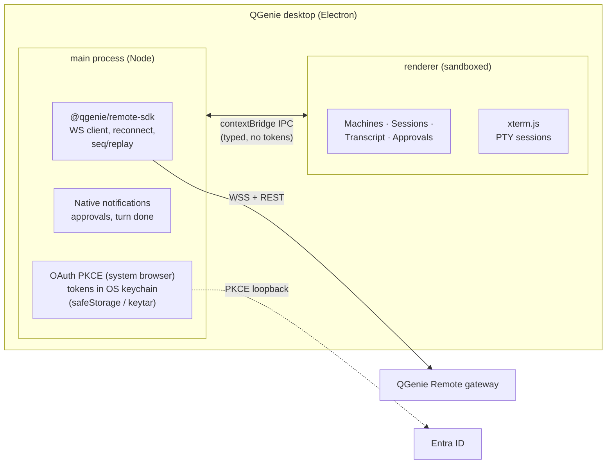

- The WebSocket connection and tokens live in the main process, which sets the `Authorization` header on the upgrade like the TUI does. The renderer never sees tokens and talks to the main process only through a typed `contextBridge` API (`contextIsolation: true`, `sandbox: true`, `nodeIntegration: false`).
- `@qgenie/remote-sdk` is generated from the Rust protocol types (JSON Schema → TS) plus a hand-written client: connect, heartbeats, reconnect with jitter, per-session seq tracking, replay, lease handling, idempotent `session.start`. It runs the same conformance vectors as the Rust client.
- Terminal sessions render with xterm.js, which receives binary PTY frames forwarded from the main process. Agent sessions render the normalized event stream (transcript, tool cards, diff viewer, approval dialogs).
- Login: PKCE with the system browser and a loopback redirect. A custom protocol handler (`qgenie://`) is an alternative if loopback is blocked.
- Update compatibility: the app sends its protocol version in `hello`; the gateway answers `4426` when the app is too old, and the app prompts for an update.

**Laptop as host (D16).** The desktop app bundles (or installs through QGenie's normal update channel) the `qgenie` CLI and manages the laptop's host role:

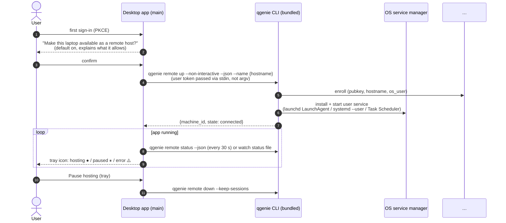

- **Opt-in once, then on by default.** The desktop app asks the first time and runs `qgenie remote up`. After that the user service starts at login and keeps the laptop online even when the app is closed. The tray toggle runs `qgenie remote down --keep-sessions` / `up`. Pause stops the connector and remote access; `sessiond` and local sessions continue. Org policy can force hosting on or off.
- **Laptop-specific behavior:** on sleep, the connection drops and the machine shows as "sleeping" (not "offline/error"). Running agents resume after wake. Optionally block sleep (macOS `caffeinate`-style assertion / Windows `SetThreadExecutionState`) while an agent turn is active, controlled by a user setting; default off on battery.
- **Visibility:** a tray indicator plus a notification whenever a remote client attaches to a session on this laptop. The user can kill remote sessions locally.
- **Safety defaults for laptops:** allowed roots default to the user's code folders (not `~`), and terminal sessions are allowed but require the approval mode for agents. Both can be changed in settings.

### 4.6 Data stores

| Store | Holds | Notes |
| --- | --- | --- |
| PostgreSQL (latest stable) | users (from IdP subject), machines, machine keys, enrollments, sessions (metadata), approvals, policies, audit log, recordings (agent transcripts + terminal output, partitioned), legal holds | Source of truth. Transcripts optionally in a separate database/cluster. RLS on transcript tables. |
| Redis (latest stable) | Pub/sub channels; presence keys; leases cache; rate-limit counters; sweeper lock | Ephemeral: an outage interrupts cross-node traffic until failover, but nothing durable is lost. See §4.3. |
| Host SQLite + files | Session registry, bounded live replay logs, separate disk-capped recording spool and coalesced gap metadata, adopted-session mappings, agent-specific IDs (Codex thread IDs, Claude session IDs) | On the host, user-owned, `0600`. Sessions continue at spool exhaustion (§4.4). |

### 4.7 Codex remote control: loopback only (D15)

Codex ships its own remote-control relay (`codex remote-control`, `codex app-server daemon enable-remote-control`). QGenie Remote must be the only path into a machine, so:

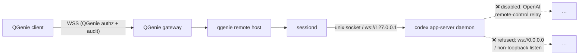

- **Managed config:** QGenie's existing Codex configuration management (`qgenie config codex`, managed `config.toml`) disables remote control (`disable-remote-control` state; the exact config key is to be confirmed against the pinned Codex version) and pins the app-server transport to `unix://` or `stdio://`.
- **Adapter guard:** `sessiond` only connects to app-server endpoints that are Unix sockets owned by the same user, or `127.0.0.1` / `::1`. It refuses others and logs a policy event.
- **Detection:** the host connector checks Codex's daemon status (`codex app-server daemon version` / `--json` status) at startup and every few minutes. If remote control is enabled, or the app-server listens on a non-loopback address, it reports a policy violation to the gateway, shows a warning in `qgenie remote doctor` and the desktop tray, and (org policy) runs `codex app-server daemon disable-remote-control`.
- **Claude Code Remote Control** is disabled or ignored. QGenie's managed Claude settings turn it off where a setting exists. Where it doesn't, it is ignored: it requires a claude.ai subscription login, which QGenie-managed Claude doesn't use, so it can't connect. The host does not need to enforce anything for Claude beyond reporting it in `qgenie remote doctor`.
- Any future vendor relay is handled the same way: disabled in managed settings if possible, otherwise reported.

### 4.8 Adopting sessions started outside QGenie Remote (D18)

Sessions a user starts on their own (an agent in a terminal, a `claude --bg` job, a tmux session) appear in the machine's session list next to the ones QGenie Remote started, as long as they run as the same OS user as the host daemon ("the user's space").

**Host machine: OS user aparkhi**

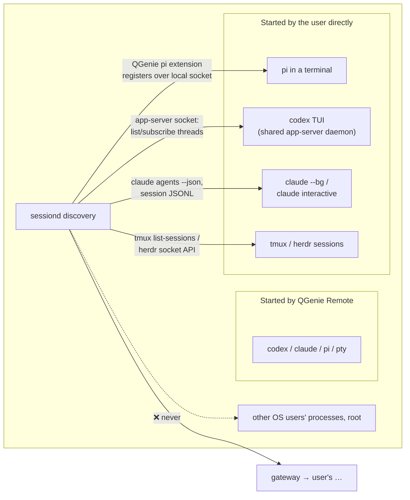

| Source | Discovery | Control available | Fallback |
| --- | --- | --- | --- |
| Codex (any session on the shared `codex app-server daemon`, including the normal codex TUI) | Connect to the user's daemon socket (`~/.codex/app-server-control/app-server-control.sock`), list threads, subscribe to events | Full: prompt, steer, interrupt, approvals (same protocol QGenie uses) | Codex processes not on the daemon: tail the rollout file read-only; "resume here" starts `thread/resume` on the daemon |
| Claude Code background sessions (`claude --bg`) | `claude agents --json` | Full through `claude attach <id>` in a managed PTY | — |
| Claude Code interactive sessions in another terminal | `claude agents --json` + session JSONL under `~/.claude/projects` | Observe-only (tail the transcript) | "Resume here" (`claude --resume <id>`) once the original terminal exits |
| Pi | The QGenie Pi extension (already needed for approvals) registers each running Pi process with `sessiond` over the local socket | Full: prompt, steer, follow-up, abort, approvals via the extension | Pi without the extension: tail `~/.pi/agent/sessions/*.jsonl` read-only |
| tmux | `tmux list-sessions` on the user's default socket | Full terminal via `tmux attach -t` in a managed PTY (or tmux control mode) | — |
| Herdr | Herdr socket API (`herdr terminal session observe/control`) | Full terminal, respecting Herdr's single-controller rule | — |
| Plain shells in an arbitrary terminal window | Not discoverable (no access to another program's PTY) | — | Out of scope |

**"User's space" rules (enforced on the host):**

- Only processes, sockets and files owned by the same UID as the host daemon. Socket peers are checked with `SO_PEERCRED` / `getpeereid` (Windows: the token's user SID). Files must be owned by the user and not group/world-writable.
- Never root's or other users' sessions, even if readable. Discovery never uses `sudo`.
- An existing same-user session whose cwd is outside the allowed roots allows full remote control by default when supported by its adapter/session kind: input, approvals, interrupt, resize, and termination. Its transcript and recording remain visible. Cwd outside the roots is not a denial reason and does not downgrade an adapter's control capability to observe. Identity, current access, the control lease, agent/terminal policy, and termination confirmation remain enforced. Allowed roots scope directory browsing, new-session cwd selection, and file transfer; they do not restrict control of existing sessions.
- Adapter capability remains authoritative: an observe-only native interface cannot gain input control from a folder-policy change. The client shows the adapter's supported actions; policy imposes no additional restriction merely because the session cwd is outside the roots.
- Adoption and recording/backfill are automatic after host enrollment, with no separate enable step. Enrollment discloses this behavior. Adoption can be switched off per agent in host config.

**Lifecycle and recording:** an adopted session gets a QGenie session ID and `origin: external`. It's recorded automatically (§4.4) from the moment of adoption, with a backfill from the agent's own log for earlier turns. Terminating it from a client is allowed only with control capability and asks for confirmation, because the user started it elsewhere. If the external process exits, the session moves to `exited` like any other.

## 5. Data model

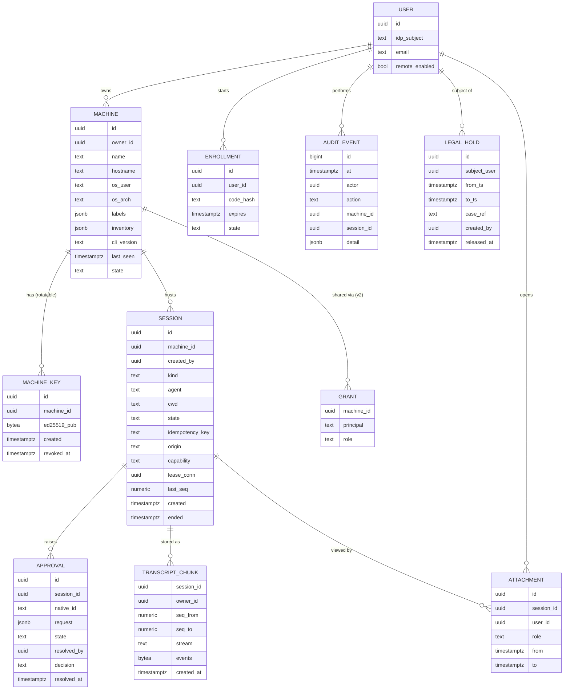

Session kind: `pty` | `agent` | `exec`. `origin`: `qgenie` | `external` (§4.8). `capability`: `control` | `observe`. Session state: `starting` → `running` ↔ `idle` → `exited` | `failed` | `lost`. `lost` means the host restarted without the session.

## 6. Key flows

### 6.1 Enrollment (`qgenie remote up`)

```mermaid
sequenceDiagram
    autonumber
    actor U as User
    participant H as qgenie (host)
    participant E as Entra ID
    participant G as Gateway REST
    participant PG as Postgres
    participant K as OS keyring
    U->>H: qgenie remote up
    alt local browser available (desktop session, no SSH)
        H->>E: auth code + PKCE, loopback redirect<br/>(scope qgenie-remote/Remote.Control)
        E-->>H: access token (user)
    else headless (SSH_CONNECTION set, no DISPLAY, or --device-code)
        H->>E: POST /devicecode (client_id, scope)
        E-->>H: user_code, verification_uri, interval
        H-->>U: "Open https://microsoft.com/devicelogin and enter ABCD-EFGH"
        U->>E: sign in on laptop/phone (MFA, Conditional Access)
        loop every interval
            H->>E: poll /token (device_code)
        end
        E-->>H: access token (user)
    end
    H->>H: generate Ed25519 key pair
    H->>K: store private key (non-exportable where supported)
    H->>G: POST /v1/machines/enroll {installation_id, pubkey, proof, hostname, os_user, os/arch, name, labels}<br/>(Bearer user token)
    G->>PG: find/create by owner + persisted installation identity<br/>verify signing proof; hostname is metadata
    G-->>H: machine_id
    H->>H: install + start user service (reuse proxy service installer)
    Note over H: user token discarded /<br/>not used by service
```

### 6.2 Host connect and presence

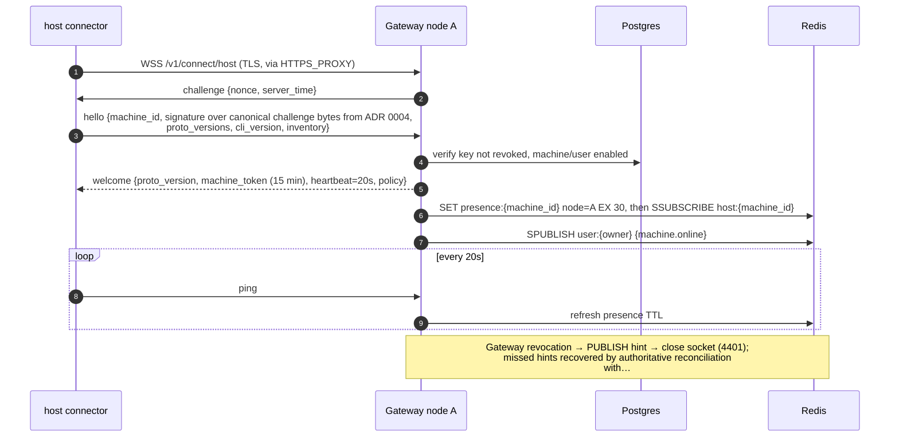

### 6.3 Client lists machines and starts a Codex session

```mermaid
sequenceDiagram
    autonumber
    actor U as User (TUI)
    participant C as qgenie TUI
    participant GB as Gateway node B
    participant N as Redis
    participant GA as Gateway node A
    participant H as host connector
    participant S as sessiond
    participant X as …
    C->>GB: WSS /v1/connect/client (Bearer user JWT)
    GB-->>C: welcome + snapshot [machines, presence, sessions], then SSUBSCRIBE user:{id}
    U->>C: new session: codex, cwd=/…/repo, prompt
    C->>GB: session.start {req_id, idem_key, machine_id, agent:codex, cwd, prompt}
    GB->>GB: authz (owner? feature on?)
    GB->>N: SPUBLISH host:{machine_id}
    N->>GA: deliver
    GA->>H: session.start
    H->>H: host policy: cwd in allowed roots? codex allowed?
    H->>S: start (idem_key)
    S->>X: thread/start {config}, then turn/start {prompt}
    S-->>H: session.started {session_id, seq:1}
    H-->>GA: session.started, GA publishes to sess:{session_id} / conn:{conn}
    GA->>GA: PG insert SESSION (state running)
    N-->>GB: deliver
    GB-->>C: session.started; C observes and requests control separately<br/>writable only after durable generation activation
    loop streaming
        X-->>S: item/agentMessage/delta, turn/command…
        S->>S: append to replay log (seq++)
        S-->>C: session.event {seq, …} (via H, GA, N, GB)
    end
```

### 6.4 Approval decision and native application

```mermaid
sequenceDiagram
    autonumber
    participant X as agent (codex)
    participant S as sessiond
    participant G as Gateway
    participant PG as Postgres
    participant C1 as TUI (laptop)
    participant C2 as Desktop app

    X->>S: approval request (native id)
    S->>G: approval.requested {approval_id, session_id, summary, command/diff}
    G->>PG: insert APPROVAL state=pending
    G-->>C1: approval.requested
    G-->>C2: approval.requested (+ notification)
    C2->>G: approval.resolve {approval_id, decision: allow_once}
    G->>G: verify owner and current access; no control lease required
    G->>S: preflight native pending state, decision and current host policy
    S-->>G: bound policy revision and expiring preflight result
    G->>PG: commit conditional winner + audit + delivery obligation
    G-->>C1: approval decision committed
    G-->>C2: approval decision committed
    G->>S: retry durable decision identity until terminal result
    S->>S: journal decision and recheck policy/access/native pending state
    S->>X: native approval response when valid
    S-->>G: applied / already_applied / cancelled / outcome_unknown
    G-->>C1: native application status
    G-->>C2: native application status
    C1->>G: approval.resolve (late)
    G-->>C1: error already_resolved
```

### 6.5 Disconnect, reattach, and replay

```mermaid
sequenceDiagram
    autonumber
    participant C as Client
    participant G as Gateway
    participant H as host + sessiond

    Note over C,G: laptop sleeps#59; WSS dropped
    H->>H: session keeps running, events appended (seq 120..480)
    C->>G: reconnect, session.attach {session_id, from_seq:"119", role: observer}
    G->>G: authorize observation; control requires separate activation
    G->>H: attach {conn, from_seq:119}
    alt from_seq still in replay log
        H-->>C: replay seq 120..480, then live
    else too old (log truncated)
        H-->>C: snapshot {transcript summary / PTY screen}, then live from current seq
    end
    Note over C,H: PTY: snapshot = rendered vt100 screen + scrollback tail
```

**Uncertain outcomes:** if the connection drops after `session.start`, the client reports `unknown` and queries the original key at sessiond. A proven accepted operation can continue under that key. An ambiguous native launch remains uncertain until reconciled; no new process is launched from a timeout alone. Input is never replayed automatically. Input acknowledgment and output cursors remain separate.

### 6.6 Terminal session (PTY) data path

```text
keystroke → TUI ─[binary frame: type=0x01 stream=sid seq=n bytes]→ GW(B) ─Redis→ GW(A) → host → sessiond → PTY master
screen    ← TUI ←[binary frame: type=0x02 stream=sid seq=m bytes]─ GW(B) ←Redis─ GW(A) ← host ← sessiond ← PTY ou…

priority: input/resize/cancel/approval > agent events > bulk PTY output
```

## 7. Protocol

The protocol lives in the `qgenie-remote-proto` crate. Rust types are the definition. `schemars` exports JSON Schema, from which the TS types for the desktop app are generated. It is versioned as `v1.x`; both sides negotiate a version and capabilities in `hello` / `welcome`.

Text frame (JSON envelope):

```jsonc
{
  "v": 1,
  "id": "msg_550e8400-e29b-41d4-a716-446655440000", // envelope ID
  "re": "msg_550e8400-e29b-41d4-a716-446655440001", // optional request envelope ID
  "type": "session.event",
  "machine": "m_550e8400-e29b-41d4-a716-446655440002",
  "session": "s_550e8400-e29b-41d4-a716-446655440003",
  "seq": "4812",           // decimal string; per-session output sequence assigned by sessiond
  "body": { "kind": "agent.item", "item": { "type": "command", "status": "running", "command": "cargo test" } }
}
```

Binary frame (PTY): `| u8 type | u8 flags | u16 reserved | 16B session_id | u64 seq | payload… |`. Integers use network byte order. For input, the payload starts with `u64 host_generation` and `u64 controller_generation` before the PTY bytes. [ADR 0004](docs/adr/0004-wire-contract.md) defines exact bounds, full-u64 JSON string encoding, identity types, compatibility, and canonical challenge bytes.

Message families:

| Family | Messages |
| --- | --- |
| Handshake | `hello`, `welcome`, `challenge`, `token.refresh`, `goodbye{code}` |
| Presence/inventory | `machine.online/offline/updated`, `inventory.update` |
| Filesystem (scoped) | `fs.list {path}` (only within allowed roots) |
| Sessions | `session.discovered`, `session.adopt`, `session.start`, `session.started`, `session.attach`, `session.detach`, `session.lease.request/granted/revoked`, `session.input` (agent prompt/steer), `session.interrupt`, `session.terminate`, `session.resize`, `session.event`, `session.snapshot`, `session.exited` |
| Approvals | `approval.requested`, `approval.resolve`, `approval.resolved`, `approval.cancelled` |
| Exec (P1) | `exec.start`, `exec.stdout/stderr`, `exec.exit` |
| Errors | `error {code, retryable, outcome: not_sent \| unknown \| rejected}` |

Normalized agent events (shared by all adapters; adapter-specific extras go in `native`): `turn.started`, `message.delta`, `message.completed`, `reasoning.summary`, `tool.started`, `tool.output`, `tool.completed`, `file.diff`, `turn.completed{usage}`, `agent.idle`, `agent.error`. Every adapter advertises its capabilities, e.g. `{steer: true, interrupt: true, approvals: ["command", "patch"], resume: true}`. Clients render only what each adapter supports.

WebSocket close codes: `4401` unauthenticated/revoked, `4403` forbidden, `4408` heartbeat timeout, `4409` replaced by newer connection (same machine), `4426` upgrade required (version too old), `4503` node draining (reconnect elsewhere).

## 8. Security model

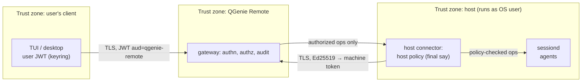

1. **Separate scopes:** a QGenie inference token can't connect to Remote, and a machine token can't act as a user.
2. **Defense in depth:** the gateway authorizes every message, and the host re-checks its own policy (roots for browsing/new-session cwd/file transfer, agents, terminal allowed, approval mode). Existing same-user sessions retain supported control outside the roots (§4.8). A compromised gateway still can't make a host run something its local policy forbids. Org policy can set the host policy, and the host shows it locally.
3. **No inbound ports on hosts.** `sessiond` IPC is a Unix socket with mode `0600` (or a named pipe with an ACL for the current user only), plus a check of the peer's credentials.
4. **Revocation:** gateway-admin/user revocation and upstream Entra disablement have separate propagation paths. Gateway revocation takes effect within 10 s of commit; Entra disablement blocks user and enrolled-machine access within 15 minutes of disablement, including detection. Both block remote access while preserving running host sessions. The paths are specified below.
5. **Control lease:** only the lease holder can send input, resize, or interrupt. Clients without that lease can observe session output; owner approval rights are separate (§8.6). Takeovers are audited.
6. **Approvals:** any connected client authenticated as the session owner may answer, subject to current access and host policy. No control lease or writable attachment is required. Viewing without input control does not remove the owner's approval rights; an outside-root cwd is not an approval-denial reason when the adapter supports approvals (§4.8). Record who answered, from which client, with what decision, and the exact request shown (a hash of the command/diff). Answers from revoked users/connections are refused.
7. **Not a sandbox:** agents run with the OS user's permissions. The product states this clearly. Admins can force approval mode for commands and limit roots for directory browsing, new-session cwd selection, and file transfer. Existing-session control is permitted outside the roots when supported (§4.8).
8. **Recording:** recording is enabled for every session, including terminal output (§4.4); users are told this up front. Sessions continue during recording failures or spool exhaustion, with explicit recording gaps and alerts. Adopted sessions are limited to the same OS user (§4.8).
9. **Transcripts:** readable only by the owner and platform admins (D14), enforced in the API and by Postgres RLS. Admin reads require a reason and are audited, without notifying the user. Legal holds can only be placed or released by platform admins, are invisible to the user, and are audited.
10. **Single remote path:** Codex's built-in relay is disabled by managed config (D15). The host doctor flags any agent remote-control listener that isn't loopback. Claude Code Remote Control is disabled or ignored (§4.7).
11. **Secrets:** never logged (reuse the CLI's redaction list). Agent provider credentials stay on the host. QGenie endpoint injection supplies model access.
12. **Threat-model items to review:** a compromised client takes over a session (mitigated by the lease, re-authentication for takeover, notifications); malicious prompt injection on the host (out of scope; approvals help); replay of signed host challenges (nonce + timestamp); cross-tenant routing bugs (authz checks the session→machine→owner chain on every message; fuzz tests).

**Gateway revocation path (MVP):**

- A platform admin invokes `POST /v1/admin/revocations` on `qgenie-remote.qualcomm.com`. The API commits the global/user/machine disable state and its audit event in one Postgres transaction. Repeated requests use an idempotency key. Success means the disable state is durable; the response reports whether propagation is complete or pending.
- The accepting gateway immediately denies further affected operations and closes affected local client and host sockets after commit. It publishes a Redis invalidation hint. Other gateways invalidate their cached state and close affected connections on receipt. User revocation covers the user's enrolled machines, including hosts authenticated with machine tokens.
- Every gateway reconciles authoritative disable state at least every 5 s, with batched checks for its connected principals. New connections check the durable state. Cached permission cannot survive beyond the 10 s revocation bound: if authoritative reconciliation cannot complete by that deadline, deny remote access and close the affected connections. Redis broadcasts and token expiry alone cannot satisfy the bound. Measure this path under the §9.7 load.
- Revocation sends no process-termination commands. `sessiond` and its running agent/PTY sessions continue locally when revoked sockets close. Pending approvals remain pending under their existing timeout/cancellation policy; revocation does not grant them. Session termination requires a separate explicit action. The connector reports denied access locally and backs off reconnect attempts; it does not automatically re-enroll a revoked machine.

**Entra disablement path:** disablement must block both user access and access from that user's enrolled machines within 15 minutes of the Entra change, including detection and the gateway's enforcement interval. A directory synchronization or supported change-event integration must detect disabled users even while their JWTs and machine credentials remain valid. When disablement is detected, update the durable gateway disable state and use the same enforcement path above; host sessions continue locally.

The directory integration remains to be selected and validated. Its detection/verification interval and request deadlines must leave room for the gateway's 10 s enforcement bound inside the total 15-minute budget. Track the last authoritative enabled-state verification per user; if it becomes too old to meet that budget, block remote access rather than treating old JWTs or machine credentials as evidence that the user remains enabled. Keep directory status separate from manual gateway disable state so stale or successful directory updates cannot clear an admin revocation. Test detection failures as well as normal disablement.

## 9. Deployment (v1: one on-prem deployment, Docker Compose)

For v1 there is exactly one deployment: one site, on-prem servers, everything in Docker containers managed by Docker Compose.

**Hardware:** each server has **128 cores, 1 TB RAM and 4–5 TB of storage.** More servers can be added.

Phasing:

- **Dev (now): one server.** Everything runs on it in single-server mode (§9.3). As §9.7 shows, one server has enough CPU and memory for the full 30k-user load. What it lacks is redundancy.
- **Production: three servers (§9.3),** for redundancy and to keep the Postgres standby and backups on separate machines. Redis and Postgres run as containers in that deployment. Kubernetes, managed databases and additional sites are deferred (§9.6). The images and their configuration contract are written so those can be added later without code changes.

### 9.1 Images

| Image | Contents | Runs as |
| --- | --- | --- |
| `qgenie-remote-gateway` | Static Rust binary (musl) on `distroless/static` + CA bundle, ~15–25 MB. Subcommands `serve`, `migrate`, `jobs` | Non-root UID 10001, read-only root filesystem |
| `haproxy` (upstream, pinned) | Edge: TLS termination, WebSocket upgrade, health-checked balancing. Our config is mounted | Non-root |
| `redis` (upstream, latest stable, pinned) | Redis server and Sentinel (same image, different command) | `redis` user, AOF off (ephemeral data) |
| `postgres` (upstream, latest stable, pinned) | Primary and streaming-replication standby | `postgres` user, data on a host volume |
| `pgbouncer` | Connection pooling for the gateways | Non-root |
| `otel/opentelemetry-collector` | Forwards metrics/logs/traces to `aiplatforms-otel` | Non-root |
| `pgbackrest` (or postgres image + script) | Scheduled base backups + WAL archiving | Runs on the backup server |

Images are built in CI, signed (cosign), scanned, tagged by version and git SHA, and pushed to the internal registry. Every image tag is pinned in the Compose files; upgrades are explicit.

### 9.2 Container contract

| Concern | Contract |
| --- | --- |
| Config | Environment variables from a per-server `.env` (`QGR_DATABASE_URL`, `QGR_REDIS_URL` (`redis+sentinel://…`), `QGR_OIDC_ISSUER`, `QGR_OIDC_AUDIENCE`, `QGR_PUBLIC_URL`, `QGR_NODE_ID` (defaults to container hostname), `QGR_LISTEN=0.0.0.0:8080`, `QGR_ADMIN_LISTEN=0.0.0.0:9090`) plus an optional mounted `config.toml` for policy defaults |
| Secrets | Mount secret files that are readable by gateway UID 10001 or its dedicated group. Verify actual in-container permissions. Root-owned mode `0400` alone is insufficient. Never store secrets in images, `.env`, or Git |
| Ports | Only edge port 443 is externally reachable. Four development gateways use HTTP ports 8081–8084 and health/metrics ports 9091–9094 on loopback. Production private addresses require explicit firewall rules |
| Readiness | Require current Postgres authority and a schema inside the binary's supported range. Redis failure permits ready/degraded same-node service. Postgres loss or draining makes the node unready. Enforce access expiry independently |
| Shutdown | On `SIGTERM`: not-ready → stop accepting → send `4503 draining` → wait up to `QGR_DRAIN_SECONDS` (60) → exit. Compose `stop_grace_period: 75s` |
| Logs | JSON to stdout (Docker `local` log driver with rotation); OTLP to the collector |
| State | Gateways keep none. Only Postgres (and backups) are durable |
| Coordinated work | Retention/hold jobs require PostgreSQL lifecycle coordination. Redis locks can schedule disposable presence work but cannot authorize deletion |
| Restart policy | `restart: unless-stopped` for all long-running services; Docker starts on boot (`systemctl enable docker`) |

### 9.3 Topology: three servers, one Compose project each

Compose manages containers on a single host, so the deployment is three Compose projects, one per server, built from one shared `compose.yaml` and selected with profiles (`edge`, `gateway`, `redis`, `sentinel`, `pg-primary`, `pg-standby`, `backup`).

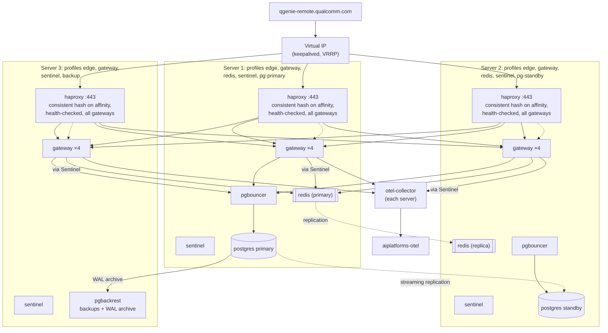

- **Networking:** containers publish their private ports on the servers' private NIC (or a WireGuard mesh between the servers). Only HAProxy's `:443` is exposed to the corporate network and reachable through the corporate VPN. The gateway does not require public-internet ingress. Host firewalls allow only the server-to-server ports (Redis 6379/26379, Postgres 5432, PgBouncer 6432, gateway 8080/9090).
- **Edge:** each server runs HAProxy, and the virtual IP moves between servers with keepalived. Every HAProxy balances across all gateways on all three servers (consistent hashing on `X-QGR-Affinity`, health check on `/healthz/ready`), so one gateway draining or a whole server going down doesn't take its share of connections offline. WebSocket idle timeout ≥ 120s, `X-Forwarded-For` for audit.
- **Redis:** primary on server 1, replica on server 2, Sentinel on all three (quorum 2). Gateways connect through Sentinel and follow failovers automatically.
- **Postgres:** primary on server 1, streaming-replication standby on server 2. Failover is manual in v1 (a runbook step: promote the standby, then repoint PgBouncer). Add Patroni for automatic failover later if the failover-time target requires it. Backups (base backups + WAL archive, point-in-time recovery) go to server 3 and then to a storage location separate from these servers.
- **Capacity:** the proposal uses four gateways per server and targets up to 40k sockets per container. These are unverified sizing assumptions. With host networking, define each instance's unique HTTP/health ports and node ID explicitly; scaling identical port bindings is invalid. See [ADR 0006](docs/adr/0006-deployment-and-readiness.md).
- **Host networking:** HAProxy and gateways use `network_mode: host`. At 100k+ connections this avoids Docker's NAT and connection-tracking overhead.

**Single-server mode (the dev setup, now):** the same `compose.yaml` with all profiles on one machine (`--profile all`):

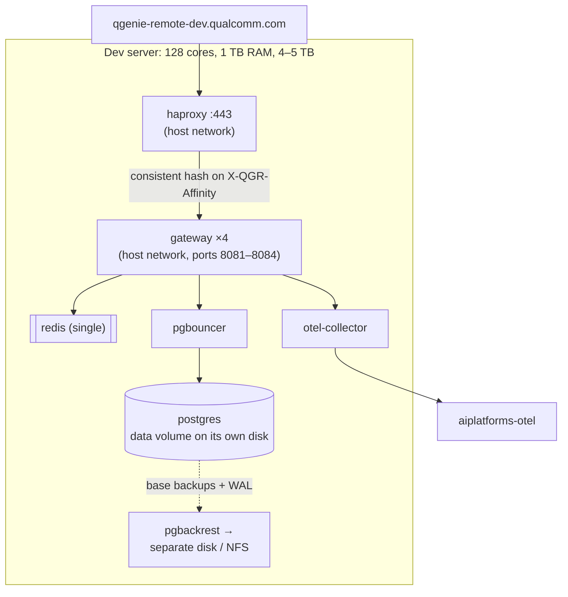

- Four gateway containers (not one), so rolling restarts and the affinity routing work the same as in production.
- Redis runs without Sentinel. Postgres has no standby. Backups still run, going to a different disk or an NFS share.
- Not highly available: if the server is down, QGenie Remote is down. Running sessions on hosts continue, and clients and hosts reconnect when it's back.

### 9.4 Install and upgrade

```text
deploy/compose/
├── compose.yaml                    # all services, grouped by profile
├── env/
│   ├── server1.env                  # profiles + addresses for each server
│   ├── server2.env
│   └── server3.env
├── haproxy/haproxy.cfg
├── keepalived/keepalived.conf
├── redis/{redis.conf,sentinel.conf}
├── postgres/{postgresql.conf,pg_hba.conf}
├── otel/collector.yaml
├── secrets/                        # not in git: TLS cert/key, DB passwords, OIDC client secret
└── scripts/
    ├── install.sh                  # docker login, pull, create volumes/secrets, start profiles for this server
    ├── upgrade.sh                  # migrate, then gateways one server at a time
    ├── pg-failover.sh               # promote standby, repoint pgbouncer
    └── backup-restore.sh            # restore drill
```

- **First install:** run `scripts/install.sh server1|server2|server3` on each server. It pulls pinned images, creates volumes and secrets, and starts that server's profiles. `migrate` runs once from server 1.
- **Upgrade:** `upgrade.sh` runs `docker compose run --rm gateway migrate` (migrations are backward compatible for one release), then on each server in turn `docker compose up -d --no-deps gateway`. Draining containers send `4503`, and clients and hosts reconnect to the other servers. Sessions are unaffected because hosts own them.
- **Redis/Postgres upgrades:** minor versions one node at a time (replica first). Major Postgres upgrades go through a planned maintenance window with `pg_upgrade` or logical replication, as a runbook.
- **TLS:** the certificate for `qgenie-remote.qualcomm.com` is issued by the internal certificate authority, which supports automatic renewal. It is mounted into HAProxy as a secret, and HAProxy reloads on renewal without dropping connections. The exact renewal integration is an implementation detail for later; for M0, a manually issued internal certificate is enough.

### 9.5 Operations

- **Backups:** Postgres holds transcripts and legal holds. Point-in-time recovery with retention long enough for legal hold requirements, copied off the deployment servers. Monthly restore drill. Redis is not backed up (ephemeral).
- **Monitoring:** Prometheus scrape of `/metrics` (or via the OTel collector), alerts on active connections, ready gateways, Redis failovers, Postgres replication lag, backup age, and disk usage on the Postgres volume.
- **Failure behavior:**

| Failure | Effect | Recovery |
| --- | --- | --- |
| One gateway container | Its sockets reconnect to other gateways within seconds | Docker restarts it |
| Server 3 | Lose 4 gateways + 1 Sentinel + backups target; their users reconnect to the others; service continues | Fix server; backups resume |
| Server 2 | Lose 4 gateways, Redis replica, Postgres standby; service continues without redundancy | Fix server; replicas resync |
| Server 1 | Sentinel promotes Redis on server 2 automatically; Postgres needs manual promotion: control operations fail until then, live sessions on hosts keep running | Run `pg-failover.sh` (target < 15 min); rebuild old primary as standby |
| Redis failover | Short gap in cross-gateway delivery; repaired by sequence-number resync | Automatic |

### 9.6 Deferred (not in v1)

- Kubernetes: the images and config contract (§9.2) already work there; it needs a Helm chart (Deployment, Service, Ingress, PDB, HPA on connection count, `migrate` Job).
- Managed Redis/Postgres: just change `QGR_REDIS_URL` / `QGR_DATABASE_URL`.
- Automatic Postgres failover (Patroni) if the manual failover target is too slow.
- More sites/regions: a host connects to its nearest site. Cross-site routing needs a forwarding hop between site Redis instances (Redis pub/sub doesn't federate), which is the main point where NATS would be reconsidered.

### 9.7 Capacity plan (30k users)

Inputs: **30,000 users**, 2–3 devices each (planning value: 3), so about **90,000 enrolled machines**. Mix: laptops plus Linux servers.

Assumptions (planning values, to be replaced with measurements from the dev deployment):

| Quantity | Assumption | Result at peak |
| --- | --- | --- |
| Hosts online | Servers always on; laptops online during working hours; ~70% of machines connected at peak | ~65,000 host sockets |
| Client connections | ~50% of users connected at peak, 1–2 clients each (TUI, desktop) | ~25,000 client sockets |
| Total sockets | — | ~90,000 (plan for 200,000 = 2x headroom) |
| Live sessions | ~30% of users active, ~2 sessions each, plus adopted sessions | ~20,000 streaming, ~60,000 listed |
| Messages | Agent deltas coalesced on the host every 50 ms; terminal output every 16 ms or 32 KB | ~100k–200k frames/s |
| Bandwidth | ~5 KB/s average per streaming session | ~100 MB/s (~0.8 Gbit/s) through the gateways |

**Gateways:** a Rust/tokio gateway holds roughly 50–100 KB per idle socket (buffers, TLS is at HAProxy). 200k sockets need about 10–20 GB RAM and a few cores for heartbeats. That is a small fraction of one 128-core, 1 TB server. 12 containers (4 per server) at up to 40k sockets each give 480k sockets of capacity, so losing a whole server still leaves more than 2x headroom.

**HAProxy:** about 200k concurrent TLS connections. Plan ~16 threads (`nbthread 16`) and ~20 GB RAM per HAProxy at full load. `maxconn 300000`; `tune.bufsize 32768`.

**Redis:** with user affinity (§4.3), most traffic stays inside one gateway, and Redis carries presence (65k keys refreshed every 20 s = 3.3k writes/s), user events, revocations, and cross-container traffic, roughly 10–30k msg/s. A single Redis process handles that easily. Without affinity (the fallback), all ~200k frames/s would cross Redis. Then run Redis Cluster with 6–12 shards on the same servers, since sharded pub/sub spreads channels across shards.

**Postgres storage (the real constraint).** Recording is mandatory, so storage grows with usage. Measured on one heavy agent user on this machine: about 62 MB of raw Codex session logs in 30 days, which compresses about 5:1 with zstd to ~12 MB, or ~0.6 MB per working day (Pi logs compress about 18:1). Terminal output and long build logs come on top of that, so the table brackets 0.5–2 MB per day.

The table below is a 90-day baseline, not a validated production size. Monthly purge rounding can retain about 120 days at the default cutoff: budget roughly 4/3 of the baseline for that rounding alone, then add held copies, WAL, standby/backup storage, and working space. The traffic duty cycle and representative recording volume still need measurement before choosing data volumes.

| Per active user per working day (compressed) | 90-day volume (21,000 active users, 63 working days) | With indexes, TOAST, bloat (+30 %) |
| --- | --- | --- |
| 0.5 MB (light) | ~0.7 TB | ~0.9 TB |
| 1 MB (typical) | ~1.3 TB | ~1.7 TB |
| 2 MB (heavy: long agent runs + build logs) | ~2.6 TB | ~3.4 TB |

- One 4–5 TB server can hold 90 days at the typical estimate, but is tight at the heavy estimate once WAL and working space are added. In production, the primary and the standby each need that space, and backups need about as much again on separate storage.
- Recommendations:
  - Put the Postgres data directory on its own disk (or dedicated NVMe), separate from Docker and logs.
  - Alert at 60% and 75% volume usage; the retention job can drop a partition early only by changing policy, never silently.
  - For production, give the Postgres primary and standby servers ≥ 8 TB for the data volume, or add a fourth server for backups, or both.
  - Store `transcript_chunk.events` with `ALTER COLUMN events SET STORAGE EXTERNAL` (already zstd-compressed; avoids double compression).
  - Measure real volume per user during the dev phase and revisit before beta.

**Postgres memory and connections:** `shared_buffers` 128 GB, `effective_cache_size` 600 GB, `work_mem` 64 MB, `max_connections` 400 behind PgBouncer (transaction pooling, ~50 server connections per gateway container is plenty). Write volume (transcript batches every 2 s from ~20k sessions = 10k inserts/s at peak, batched per gateway) is well within one primary's capacity.

**Host OS tuning** (all servers, set by `install.sh`): `fs.file-max` ≥ 2M, `net.core.somaxconn` 65535, `net.ipv4.tcp_max_syn_backlog` 65535, `net.core.netdev_max_backlog` 65535, TCP keepalive 60s, `nf_conntrack_max` ≥ 1M (or no conntrack for host-network ports), NIC ≥ 10 GbE.

**Load test targets (before beta):** 200k simulated sockets across the gateways, 20k streaming sessions, 2k concurrent terminal sessions at 50 KB/s bursts; keystroke p99 < 150 ms; Postgres write lag < 5 s.

## 10. Code layout

```text
qgenie/                         (existing Rust workspace)
├── crates/
│   ├── qgenie-remote-proto/     # message types, framing, versioning, signing, JSON Schema export
│   ├── qgenie-remote-client/    # Rust client SDK: connect, auth, subscribe, attach (used by TUI)
│   ├── qgenie-remote-host/      # connector + host policy + service install glue
│   ├── qgenie-remote-sessiond/  # session registry, replay log, adapters (codex, claude, pi, pty, exec)
│   └── qgenie-remote-tui/       # ratatui views: machines, sessions, transcript, terminal, approvals
└── src/commands/remote.rs      # "qgenie remote …" subcommands
qgenie-remote-gateway/          (new service repo, or same workspace)
├── src/{edge,authn,authz,router,api,approvals,audit,transcripts,retention}.rs
├── migrations/                # sqlx Postgres migrations
├── Dockerfile                 # multi-stage: rust:musl builder → distroless/static
└── deploy/compose/            # the v1 on-prem deployment (see §9.4)
sdk/ts/                        # @qgenie/remote-sdk: generated TS types + Node WS client (Electron main process)
conformance/                   # protocol test vectors run against host, client, and gateway in CI
```

## 11. Testing strategy

- **Protocol conformance:** golden JSON/binary test vectors in the proto crate, run against the Rust host/client/gateway for MVP. The later TS SDK runs the same vectors.
- **Fault injection (MVP exit criteria):** kill a gateway pod during streaming; drop the client network for 10 min; sleep and resume a laptop host; restart `host` during a session (`sessiond` survives); revoke a machine while connected; two clients approve at once; duplicate `session.start` after a dropped ack; corporate proxy with a 60 s idle timeout.
- **Adapter contract tests** against each agent version that QGenie installs (Codex, Claude, Pi), in CI.
- **Load:** the §9.7 targets: 200k simulated sockets, 20k streaming sessions, 2k concurrent terminal sessions with bursts. Measure keystroke p99 latency, Redis throughput with and without affinity, and Postgres write lag under mandatory recording.
- **Adoption:** sessions started directly (Codex TUI, `claude --bg`, Pi, tmux) appear within 10 s; another OS user's sessions never appear; adapters with observe-only interfaces refuse unsupported input. For a controllable session outside the allowed roots, verify input, approvals, interrupt, resize, and termination as supported. The cwd alone must not deny these actions; identity/access, lease, other host policy, and termination confirmation still apply. Browsing and new-session cwd checks remain scoped to the roots.
- **Transcript access:** RLS tests (another user gets zero rows; admin without a reason is refused; every admin read is audited). Retention keeps held rows, drops monthly partitions only when the full range is older than the cutoff, and preserves content age on backfill/retries. At the default cutoff, ordinary retention may round to about 120 days.
- **Codex loopback:** CI asserts that the managed config disables Codex remote control and that `sessiond` refuses non-loopback app-server endpoints.
- **Deployment tests:** CI starts the single-server Compose stack and runs the end-to-end suite. A staging copy of the three-server layout runs failure drills: kill a gateway, stop a server, fail over Redis, promote Postgres, and do a rolling upgrade with active sessions.
- **Redis failover:** fail over the Redis primary during streaming; clients and hosts must resync from sequence numbers with no lost or duplicated output.
- **Gateway-admin revocation:** revoke global/user/machine access through the MVP admin API, suppress Redis invalidation messages, and verify denial at the accepting node immediately after commit and all nodes within 10 s. Include already-open client/host sockets, new connections, and authority failure past the reconciliation deadline. Agent/PTY sessions must continue locally after access is blocked; pending approvals must not be granted by revocation.
- **Entra disablement:** disable a user while their JWT and machine credentials remain valid. Verify user and enrolled-machine access is blocked within 15 minutes of disablement, including directory detection and gateway enforcement. Test stale/failed directory verification and confirm local sessions continue. A directory update must not clear a manual admin revocation.
- **Recording failure:** disconnect Postgres, fill the host recording spool, and verify sessions keep running, loss ranges are marked, the TUI warns, and alerts/gap metadata reach the gateway after recovery.
- **Approval rights:** an authenticated owner may answer from a client without the control lease or a writable attachment; other users and revoked connections are refused. Two owner clients still produce only one winning decision. Host policy remains enforced.

## 12. …

| Question | Decision |
| --- | --- |
| First-release client | TUI only. Rust client SDK, manual `qgenie remote up` enrollment. Desktop and TS SDK work follow after MVP. |
| Desktop app stack | After MVP: Electron. TS SDK generated from the Rust protocol, WS in the main process, xterm.js (§4.5). |
| Revocation | On-demand gateway-admin API in MVP. Deny immediately at the accepting node after commit; all nodes within 10 s through push plus bounded reconciliation. Entra disablement blocks user and enrolled-machine access within 15 minutes of the change, including detection. Host sessions continue locally (§8). |
| Gateway reachability | Corporate network or corporate VPN. No public-internet ingress required. Clients need gateway reachability, not direct host reachability. |
| Headless login | Entra device code allowed. Used automatically for SSH/headless hosts (D12). Enrollment codes deferred to P2. |
| Routing bus | Redis, latest stable (D6, §4.3). |
| Recording | Always enabled, including terminal output; Postgres, monthly partitions, 90-day cutoff rounded to about 120 days except legal holds. Sessions continue on recording failure or spool exhaustion; missing content is marked and alerted (D13, §4.4). |
| Approval rights | Any connected client signed in as the session owner, subject to current access and host policy; no control lease required. Outside-root cwd does not block approval answers when supported. |
| Outside-root sessions | Full remote control when supported: input, approvals, interrupt, resize, termination. Cwd outside the roots does not downgrade capabilities. Roots scope browsing/new-session cwd/file transfer (§4.8). |
| Pause hosting | Keep local sessions running; stop remote access. Use `qgenie remote down --keep-sessions`, resume with `up`. |
| External sessions | Automatically adopted and recorded after host enrollment when they run as the same OS user, including history backfill; no separate enable step (D18, §4.8). |
| Claude Remote Control | Disabled or ignored (§4.7). |
| Scale | 30k users, ~90k machines; sized in §9.7. |
| Hardware | 128 cores, 1 TB RAM, 4–5 TB per server; one server for dev now, three for production (§9). |
| Transcript access | Owner + platform admins only, RLS-enforced, admin reads audited (D14). |
| Legal hold | Per-user holds for select individuals, placed and released only by platform admins (single admin, no second approver); invisible to the user; held data exempt from purging (§4.4). |
| Admin-read visibility | Users are not notified when a platform admin reads their transcript; the read is recorded in the admin audit log only. |
| Codex remote control | Loopback/local IPC only; Codex's relay disabled in managed config; QGenie Remote is the only remote path (D15, §4.7). |
| Laptops | Hosts after explicit `qgenie remote up`. Users enroll through the CLI in MVP; desktop enrollment and supervision follow later (D16, §4.5). |
| TLS certificates | Internal CA with automatic renewal; integration details deferred (§9.4). |
| Deployment | v1: a single on-prem deployment with Docker Compose (three servers; single-server mode for dev). Redis and Postgres as containers. Kubernetes and more sites later (D17, §9). |

## 13. Open architecture questions

1. Which team operates the deployment (on-call, Postgres failover, backups, storage alerts)?
2. Production storage: can the Postgres primary and standby servers get ≥ 8 TB data volumes (§9.7), or should retention be revisited after measuring real volume during dev?
3. Off-server backup target for Postgres (NFS, another server, tape)?
4. Which Entra directory/change-event integration detects disabled users and supports the 15-minute total revocation bound, including verification failures?
