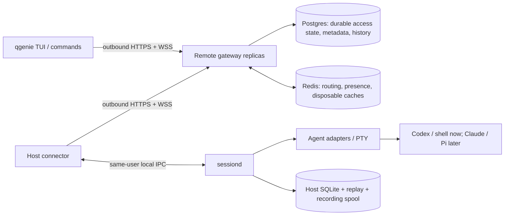
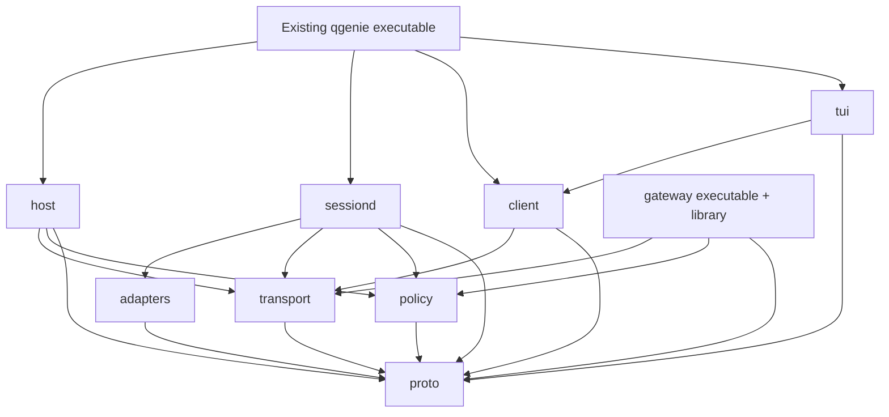

# QGenie Remote: components, crates, and file layout

Status: implementation proposal, 2026-10-16. No crates have been implemented in this repository.

This document turns PRD v0.8 and architecture v0.8 into a component map. The 2026-10-15 review supplies unresolved implementation concerns; its original findings refer to v0.7, and its follow-up records the decisions already resolved in v0.8. Crate rules are in the [subcrate standard](subcrate-standard.md).

## 1. What we are building

QGenie Remote is a way to work on a user's enrolled machines through one corporate gateway. It provides machine discovery, remote terminals, structured coding-agent sessions, approvals, durable reattachment, and recorded history. Both clients and hosts initiate outbound connections; agents and shells execute as the enrolled OS user on the host.

There are four runtime roles:

| Runtime role | Entry point | Owns |
| --- | --- | --- |
| User client | Planned `qgenie remote` TUI and scriptable commands in the existing CLI | User interaction, subscriptions, local rendering, reconnect cursors |
| Host connector | Planned `qgenie remote host`, managed as a user service | Machine authentication, outbound WSS, host policy checks, gateway-to-local dispatch |
| Session owner | Planned `qgenie remote sessiond`, with an independently managed lifetime | Running agents/PTYs, session registry, replay, recording spool, native approvals |
| Gateway | New `qgenie-remote-gateway serve/migrate/jobs` binary | Identity and access, machine/session metadata, routing, approvals, audit, transcript storage |

The host and session owner are different processes using the same distributed `qgenie` executable. A crate is a compile-time boundary; it does not imply another process, service, repository, or container.



The first release has the TUI, terminal sessions, and a validated Codex adapter. Desktop integration, the TypeScript SDK, Claude/Pi adapters, external-session adoption, and Windows hosts follow later according to the PRD. Their boundaries should be planned now, without making them MVP dependencies.

## 2. Proposed crate map

Use one workspace containing nine product crates, plus an `xtask` developer tool when build automation is needed. Six product crates follow the existing architecture layout; three explicit boundaries are added for shared transport, shared policy decisions, and native adapters. Extracting those boundaries prevents networking from being duplicated, policy from drifting, and vendor protocols from spreading through session orchestration.

| Crate | Responsibility and public surface | Direct product dependencies | Introduced |
| --- | --- | --- | --- |
| `qgenie-remote-proto` | Typed IDs, public operations/events, JSON and binary encoding, capabilities, version negotiation, wire validation, canonical challenge bytes; separately versioned internal IPC types | None | M0 |
| `qgenie-remote-transport` | Bounded connection reader/writer, priority queues, frame limits, heartbeat, WSS proxy/CA support, backoff primitives, secure local IPC plumbing | `proto` | M0 |
| `qgenie-remote-policy` | Pure operation-level decisions: owner access, action requirements, agent/terminal permissions, approval mode, policy composition | `proto` | M0 |
| `qgenie-remote-client` | Rust SDK: REST and WSS, machine/session subscriptions, attach/replay reconciliation, input acknowledgments, lease/approval APIs, start outcome handling | `proto`, `transport` | M0 |
| `qgenie-remote-adapters` | Adapter interface and native implementations; launch/connect, normalize events, answer native approvals, advertise proven capabilities | `proto` | M0: PTY and Codex; M2: others |
| `qgenie-remote-sessiond` | Session lifecycle, durable start journal, registry, controller fencing, native approval application, replay/snapshots, recording spool, adoption coordination | `proto`, `transport`, `policy`, `adapters` | M0 |
| `qgenie-remote-host` | Enrollment and machine credentials, service lifecycle integration, connector, local policy/path checks, inventory, recording uploader, diagnostics | `proto`, `transport`, `policy` | M0 |
| `qgenie-remote-tui` | Ratatui state/update/render loop, machine/session views, transcript and terminal interaction, owner approvals, recording warnings | `proto`, `client` | M0 |
| `qgenie-remote-gateway` | Axum endpoints, authn/authz, authority transactions, connection management, routing, durable delivery work, audit, recordings, jobs | `proto`, `transport`, `policy` | M0 |

Here `proto` etc. abbreviate the full crate names. The existing `qgenie` binary composes `client`, `host`, `sessiond`, and `tui`; it supplies existing OAuth, credential-store, service-management, redaction, and agent-launch integration. The gateway has both `lib.rs` for its composition/testing surface and a thin `main.rs`.

`host` does not link `sessiond`: they communicate through IPC. `client` does not know about adapters. `gateway` does not link host execution libraries. `adapters` does not depend on `sessiond`; it defines the interface that `sessiond` consumes.



Arrows mean direct compile-time dependencies. This graph must remain acyclic.

## 3. What stays a module

| Component | Initial home | Why it is not another crate yet |
| --- | --- | --- |
| Codex, Claude, Pi, PTY, exec, tmux, Herdr integration | `adapters::{codex,claude,pi,pty,exec,tmux,herdr}` | One adapter interface; isolate vendor details with modules and optional dependencies. Split a vendor implementation later if build cost or ownership warrants it |
| Host replay log, recording spool, SQLite registry | `sessiond::{replay,recording,store}` | All participate in session recovery and sequencing; keep their persistence contracts together |
| PostgreSQL repositories and Redis integration | `gateway::{store,routing}` | Only the gateway consumes them today. Expose domain operations, not a generic shared database layer |
| Gateway approvals, leases, revocation | `gateway::{approvals,leases,revocation}` | Separate state machines within one service; transactions need coordinated ownership |
| Transcript ingestion, RLS reads, holds, retention | `gateway::{transcripts,retention}` | Different capabilities and DB roles, but one storage contract; keep those boundaries explicit inside the crate |
| Individual TUI screens/widgets | `tui::{views,widgets}` | Shared UI state and release; a widget is usually a file/module boundary |
| OAuth provider, platform keyring, service installers, endpoint injection, redaction | Existing QGenie facilities through small integration interfaces | Reuse existing code after inspecting it. Do not create a second QGenie platform stack |
| Telemetry setup | Each process composition root; existing QGenie setup for CLI roles | Libraries emit tracing/metrics; process entry points configure exporters |
| Protocol conformance vectors | Workspace `conformance/` fixtures | Shared data consumed by multiple languages; no production dependency required |
| HAProxy, Compose, DB backup configuration | `deploy/` and runbooks | Infrastructure artifacts, not Rust libraries |
| TypeScript SDK and Pi extension | Later language-specific packages | They are not Rust subcrates and do not block the initial Rust build |

Avoid general-purpose `common`, `utils`, `core`, or `services` crates. Name the responsibility a dependency provides.

## 4. State authority and component contracts

The following ownership rules preserve the architecture's intent. Mechanisms marked proposed refine unresolved review findings and need ADRs and fault-test evidence before becoming guaranteed behavior.

| State | Authority | Consumers and recovery |
| --- | --- | --- |
| User enabled state, machine identity/key, manual revocation | Postgres through gateway identity/revocation modules | New connections check durable state; connected principals reconcile at least every 5 s. Deny access if authority is stale beyond the 10 s enforcement budget |
| Entra enabled-state freshness | Selected directory integration feeding Postgres; integration still unvalidated | Separate upstream status from manual revocation. Include detection and gateway enforcement in the 15-minute budget |
| Running process, native session ID, local session state, event sequence | `sessiond` SQLite and actual adapter/process | Gateway metadata is a projection. Connector/client loss leaves execution running; reboot may yield `lost` |
| Session-start idempotency | `sessiond` durable start journal | Journal before launch; correlate native IDs and reconcile interrupted starts. Gateway tracks the request, but cannot alone prove a process was created |
| Host-connection and control-lease generations | Proposed: Postgres conditional transactions; `sessiond` persists/enforces activated generations | Redis is a cache. Activate a generation at `sessiond` before acknowledging a new controller; reject obsolete mutations. No database call per keystroke |
| One winning remote approval decision | Gateway Postgres conditional transaction | Proposed: transaction includes a durable delivery obligation; retry committed decisions until the host acknowledges a terminal application result |
| Native approval request and application outcome | `sessiond` approval journal and adapter | Deduplicate remote decisions, reconcile native cancellations/local resolutions/restarts; do not claim exactly-once native execution if the vendor protocol cannot prove it |
| Live replay and PTY screen snapshot | `sessiond` bounded replay log and screen model | Client resync reads the host, never the Postgres transcript copy. Report truncated replay explicitly |
| Unacknowledged recording content and gap ranges | `sessiond` separate disk-capped spool | Host uploads immutable batches; reclaim content only after durable recording acknowledgment or the documented cap policy. Preserve gap metadata |
| … | … | … |
| … subscriptions | … state | … after failure. Affinity is an optimization, not access authority |
| Legal holds and permission to retire transcript partitions | Postgres-coordinated hold/retention transactions | Redis leadership alone cannot authorize destructive work. Preserve overlapping holds, metadata, and audit references |

### Contracts to write before implementation grows

1. **Public wire contract (`proto`).** Separate message IDs, request IDs, session IDs, idempotency keys, output cursors, input acknowledgments, and fencing generations. Fix binary endianness, frame limits, integer representation for future JS clients, sequence scope across streams, and unknown-field compatibility. Schema export covers the public API; local administrative IPC is not a public gateway operation.
2. **Local IPC contract (`proto::ipc` and `transport::ipc`).** Version independently; validate same-user socket/pipe peers and permissions. Carry remote identity/action context, current generations, and host-validated policy inputs. Separate remote dispatch from local privileged lifecycle commands. `sessiond` also validates mutation generations and policy-relevant preconditions.
3. **Adapter contract (`adapters`).** A driver advertises supported actions and emits normalized events plus native IDs. It returns bounded event receivers/command handles; `sessiond` assigns public event sequences and owns durable records. Native approval delivery has explicit `applied`, `already_applied`, `cancelled`, and `outcome_unknown` results. Existing QGenie integration supplies launch configuration without exposing provider credentials to clients/gateway.
4. **Policy contract (`policy` plus host filesystem checks).** Decisions consume typed facts and return allow/deny with stable reasons. Gateway supplies authenticated ownership/current access; host supplies local restrictions and adapter facts. Both require their checks to pass. Roots restrict browsing/new-session cwd/file transfer; outside-root existing sessions retain supported control and owner approval rights. Actual canonicalization, symlink-safe file operations, UID/SID checks, and filesystem access live on the host.
5. **Session start contract (`sessiond`).** Distinguish received, durably accepted, native launch in progress, running, failed, and outcome unknown. Reuse a persisted idempotency key on reconciliation. Never turn a timeout into a fresh start; native creation/recovery limitations need explicit outcomes.
6. **Control and approval contracts (gateway, `sessiond`).** Input/resize/interrupt use the active lease generation. Owner approvals do not require a lease. Specify termination authorization separately, including confirmation for external sessions. Validate local approval policy before choosing a winner; handle policy changes and native/local resolution races explicitly. A committed decision is not yet proof that the agent applied it.
7. **Replay contract (`sessiond`, `client`).** Define snapshot cursor, replay/live cutover, retention floor, periodic head-cursor reconciliation for a lost final frame, and `history_truncated`. Inputs are never automatically resent on reconnect. Historical recording views remain separate from live attachment.
8. **Recording contract (`sessiond`, host, gateway).** Distinct replay and recording budgets; immutable chunk IDs/boundaries/capture time; authenticate session ownership on ingest. Acknowledge only after DB commit. Spool exhaustion admits recent output by discarding oldest unacknowledged content with durable gap ranges; sessions continue. Store terminal output/resizes, not raw no-echo keystrokes. Pause leaves recording spooled locally until upload resumes.
9. **Lifecycle contract (host, platform integration).** Independently manage connector/session-owner lifetimes; `setsid` alone is insufficient on systemd. Specify Linux units/cgroups, launchd jobs, and later Windows job behavior. Connector restart, pause, and revocation preserve sessions; session-owner update, explicit termination, logout, and reboot need separate semantics.

## 5. Repository and file layout

The following is a target layout, not a list of files already created. Create modules as their behavior is implemented; do not scaffold empty future code.

```text
remote-gateway/
├── Cargo.toml                         # workspace members/dependencies/lints/profiles
├── Cargo.lock                         # committed: applications are deployed from this workspace
├── rust-toolchain.toml                # agreed pinned toolchain; choose after CLI inspection
├── rustfmt.toml
├── README.md
├── docs/
│   ├── PRD.md
│   ├── architecture.md
│   ├── components.md                  # this component map
│   ├── subcrate-standard.md
│   ├── adr/                           # state/identity/lifecycle/compatibility decisions
│   └── runbooks/                      # upgrades, failure, backups, revocation drills
├── crates/
│   ├── qgenie-remote-proto/
│   ├── qgenie-remote-transport/
│   ├── qgenie-remote-policy/
│   ├── qgenie-remote-client/
│   ├── qgenie-remote-adapters/
│   ├── qgenie-remote-sessiond/
│   ├── qgenie-remote-host/
│   ├── qgenie-remote-tui/
│   └── qgenie-remote-gateway/
├── xtask/                             # schema export, dependency checks, build/test tooling
├── conformance/{json,binary,scenarios}/
├── tests/e2e/                         # multi-process recovery/security scenarios
├── deploy/{compose,images}/
└── sdk/ts/                            # later: generated public types + Node client
```

Repository recommendation: use one workspace while these interfaces are changing. This repository can initially house the reusable crates and gateway; the real QGenie CLI consumes the crates through one coordinated integration. If the team instead places everything in the existing QGenie workspace, retain the same crate boundaries and dependency direction. Do not copy shared protocol source between repositories. Until a registry exists, pin all remote crates to the same git revision; the CLI adapters to its existing facilities live in the CLI repository.

### Files within each crate

Every product crate has `Cargo.toml`, `README.md`, and `src/lib.rs`. The source maps below omit that repetition. A `foo/` directory is a module with `foo/mod.rs`; flat files are sufficient until the concern needs multiple files.

| Crate | Proposed `src/` modules | Behavior boundary |
| --- | --- | --- |
| `proto` | `ids.rs`, `envelope.rs`, `handshake.rs`, `machine.rs`, `filesystem.rs`, `session.rs`, `approval.rs`, `events.rs`, `capabilities.rs`, `error.rs`, `binary.rs`, `version.rs`, `challenge.rs`, `ipc/{mod,request,response,version}.rs`, `schema.rs` | Public contract separated from local IPC and schema tooling. Canonical challenge encoding here; actual key storage/sign/verify in the appropriate identity implementation |
| `transport` | `config.rs`, `codec.rs`, `connection.rs`, `queues.rs`, `heartbeat.rs`, `backoff.rs`, `ws/{mod,client,server}.rs`, `ipc/{mod,unix,windows,peer}.rs`, `error.rs` | Protocol I/O with bounded resources. Server/client/IPC features prevent gateway builds from pulling local platform code unnecessarily. No session retry or OAuth policy |
| `policy` | `action.rs`, `context.rs`, `rules.rs`, `decision.rs`, `requirements.rs`, `error.rs` | Pure, deterministic decisions using caller-supplied facts. No database, environment lookup, filesystem traversal, or token validation |
| `client` | `client.rs`, `config.rs`, `credentials.rs`, `http.rs`, `connection.rs`, `subscriptions.rs`, `machines.rs`, `sessions.rs`, `replay.rs`, `leases.rs`, `approvals.rs`, `pending.rs`, `error.rs` | Stable SDK calls independent of ratatui. `pending.rs` correlates requests and preserves not-sent/unknown/rejected distinctions |
| `adapters` | `adapter.rs`, `commands.rs`, `events.rs`, `launch.rs`, `registry.rs`, `codex/{mod,client,native,normalize,approvals,guard}.rs`, `pty/{mod,process,screen,snapshot}.rs`, `error.rs`; later `claude/`, `pi/`, `exec.rs`, `tmux.rs`, `herdr.rs` | Native protocol types stay inside their adapter. Screens/snapshots belong to PTY handling; durable cursor ownership belongs to `sessiond` |
| `sessiond` | `runtime.rs`, `ipc.rs`, `registry.rs`, `lifecycle.rs`, `start.rs`, `control.rs`, `approvals.rs`, `supervisor.rs`, `replay/{mod,log,cursor,snapshot}.rs`, `recording/{mod,spool,chunk,gaps}.rs`, `store/{mod,sessions,starts,approvals,fences}.rs`, `error.rs`; later `discovery/{mod,scan,adopt,backfill}.rs` | `start.rs` coordinates durable launch; `control.rs` checks fences; storage modules persist those domain transitions. SQLite migrations are crate-local |
| `host` | `host.rs`, `config.rs`, `enrollment.rs`, `identity/{mod,key,challenge,token}.rs`, `connector.rs`, `dispatch.rs`, `ipc.rs`, `filesystem.rs`, `policy/{mod,paths,agents}.rs`, `inventory.rs`, `recording.rs`, `service.rs`, `status.rs`, `doctor.rs`, `error.rs` | `filesystem.rs` implements root-scoped directory browsing; `service.rs` uses existing QGenie installers through integration interfaces; `recording.rs` uploads `sessiond` batches and returns commit receipts; no process ownership |
| `tui` | `app.rs`, `state.rs`, `update.rs`, `input.rs`, `effects.rs`, `views/{mod,machines,sessions,transcript,terminal,approvals,history}.rs`, `widgets/{mod,status,dialog}.rs`, `error.rs` | State changes and rendering are separate; network work is driven through `client`, not inside widget rendering |
| `gateway` | `main.rs`, `app.rs`, `config.rs`, `state.rs`, `shutdown.rs`, `edge/{mod,upgrade,connection,limits}.rs`, `identity/{mod,jwt,machines,challenge,directory}.rs`, `authz.rs`, `routing/{mod,local,redis,presence}.rs`, `api/{mod,machines,sessions,admin,audit,transcripts}.rs`, `sessions.rs`, `leases.rs`, `approvals/{mod,decision,delivery}.rs`, `revocation/{mod,commit,reconcile}.rs`, `audit.rs`, `transcripts/{mod,ingest,receipts,read,holds}.rs`, `retention.rs`, `jobs.rs`, `store/{mod,identity,sessions,approvals,leases,revocation,audit,transcripts,holds,outbox}.rs`, `error.rs` | HTTP handlers call domain operations; domain operations use repositories. The outbox stores delivery obligations in the same transaction as their decisions. `directory.rs` implements the selected Entra integration once proven |

Keep PostgreSQL migrations under `qgenie-remote-gateway/migrations/`, including DB roles/RLS policies; keep SQLite migrations under `qgenie-remote-sessiond/migrations/`. Do not share their persistence schemas through `proto`.

Existing QGenie integration should split its command glue into `src/commands/remote/{mod,args,up,down,status,logs,doctor,machines,attach,run,revoke,unenroll,config}.rs` as needed, with hidden `host` / `sessiond` dispatch there. Credential-provider, service-manager, agent-launch, and redaction integration belongs beside the command composition code, not in reusable remote crate internals. Exact integration paths remain provisional until that repository is inspected.

## 6. How components collaborate

### Enrollment and machine listing

`qgenie remote up` → existing OAuth flow with the remote scope → `host::enrollment` → gateway identity API → Postgres machine/key record → service integration starts connector and independently managed session owner → `host::connector` opens WSS → gateway updates presence → client subscription updates TUI state.

Reuse the persisted machine identity/key on repeated `up`. Hostname is metadata, not a unique machine identity. Key loss, cloning, rotation, and reinstallation require explicit recovery rules. OS credential storage does not universally guarantee non-exportable Ed25519 signing; report the actual platform protection and the weaker protected-file fallback.

### Start, stream, detach, and reattach

`tui` / CLI → `client::sessions` → gateway authz/routing → host policy/path checks → `sessiond` start journal → adapter launch → registry/event log → host → gateway → client → UI. Gateways persist metadata projections without taking ownership of the process.

Detach removes client subscriptions/control, leaving execution running. Reattach negotiates a replay cursor/snapshot and reacquires control explicitly. An ambiguous start response triggers same-key lookup/reconciliation; ordinary input is not replayed automatically.

### Approve from any owner client

Adapter raises a native approval → `sessiond` journals it → gateway creates a pending record → user-wide subscriptions notify owner clients. An owner client can answer without being a controller. Gateway checks current access and host-policy validity, commits one winning decision plus its delivery obligation, and retries delivery. Sessiond deduplicates/reconciles native application and acknowledges the actual result. The UI distinguishes a decision committed from applied or unable to apply.

### Record, pause, and recover

Sessiond independently appends live replay and redacted recording batches. Host uploads recording batches to gateway ingestion; Postgres commit receipts flow back to sessiond before spool reclamation. A recording outage does not block session output/control. Spool exhaustion creates durable loss ranges and warnings.

Pause stops the connector while sessiond and its spool continue locally. Resume uploads retained content and gap metadata. Revocation closes access without sending termination. Historical reads use the transcript API with owner/admin checks and RLS, not the live replay path.

## 7. Build order and requirement coverage

| Stage | Work and primary owners | Completion evidence |
| --- | --- | --- |
| Foundation/M0 | `proto`, `transport`, `policy`; inspect actual CLI auth/service/launch facilities; settle IPC and lifecycle contracts | Protocol fixtures; remote-scope OAuth including device code; corporate proxy/CA connectivity; supported-platform service restart isolation |
| First vertical slice/M0 | `gateway`, `host`, `sessiond`, PTY adapter, `client`, minimal `tui` | Enroll lab host, list machines, start terminal through gateway, detach and reattach; reconnect and same-key start recovery |
| Codex proof/M0 | Codex adapter, relay guard, capability matrix | Actual QGenie-distributed version demonstrates prompt, events, interrupt, approval, and reconnect over a verified private endpoint; record unsupported claims explicitly |
| MVP/M1 | Owner access, fresh revocation, fenced control, durable approval delivery, TUI workflows, audit, recording path and warnings | ID-1..8, PR-1..4, SE-1/2/2a/5..11, CL-1, PO-1/3/5; crash/failover/race drills meet required behavior |
| Beta/M2 | Claude/Pi/exec, same-user adoption/backfill, Electron/TS SDK, Windows, richer org policy/admin/history operations | SE-3/4/12/12a/12b/13; CL-2/3/5/6; PO-2/4/6/7/8; adapter/local-controller coexistence, RLS/hold/retention races, representative load and recording-volume measurements |
| GA and later | Operational hardening/admin UI, then sharing/web/file transfer | Threat review, recovery/backup drills, SLO evidence; future clients pass shared conformance |

**Recording milestone proposal:** the PRD says recording is always enabled but places PO-4/6/7/8 in M2. The crate plan must not interpret that as permission to store unprotected recordings in alpha. M0 must prove recording/commit/gap semantics. If M1 records persistent content, its owner/admin access, audited admin reads, purge, and legally required hold preservation must be delivered with that content. Keep this release dependency explicit and reconcile the PRD milestone table before promising alpha dates; it is a scope proposal, not an already confirmed schedule change.

No crate is independently "done" just because its files exist. Each vertical slice should prove real behavior across process boundaries.

## 8. Decisions still needed before coding guarantees

| Decision | Owner component | What needs evidence |
| --- | --- | --- |
| Existing CLI interfaces and repository/package integration | QGenie composition + `host` / `adapters` / `client` | Actual OAuth/device grant, key storage, service installers, launch/injection, redaction, toolchain/MSRV; this repo has none of that implementation |
| Independent session-owner service lifetime | `host::service` + `sessiond` | Real systemd/launchd restart and update with active PTY and agent; do not rely only on `setsid` |
| Authority/fencing/approval application | Gateway state modules + sessiond journals | Delayed stale input, Redis failover, replaced host, lost approval delivery/ack, local native resolution, policy-change races |
| Entra disable detection | `gateway::identity::directory` | Validated directory/change-event mechanism and stale-authority behavior within the total 15-minute bound |
| Adapter capability and relay controls | `adapters` + host diagnostics | Pinned-version proofs; shared-daemon/live-adoption claims and local controller arbitration remain assumptions until demonstrated |
| Recording/hold/retention and database recovery | Gateway transcript/store modules + sessiond spool | Stable ingest receipts, transaction-local RLS context, explicit held-table policies, audited reads before bytes returned, overlapping hold preservation, RPO and receipt reconciliation after failover, backup expiry/restore rules |
| Concrete deployment contract | `deploy/` + gateway readiness/config | Four instances with unique host-network ports or a different network model, service-readable secrets, migration compatibility range, ready/degraded behavior during Redis/Postgres outages |
| Production recording volume and operating ownership | Operations + telemetry | One measured model for traffic, duty cycle, compression, rounded retention, holds, WAL, replicas, and backups; named on-call/backup owners |

These decisions may refine internal modules. They do not require turning every concern into another crate or abandoning the shared Rust workspace.
