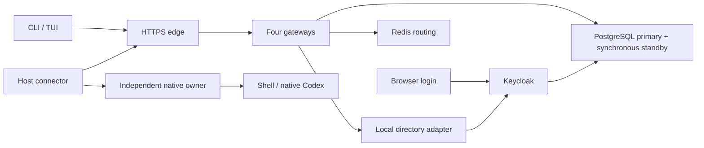

# Local application development

Use this setup to run the application with real local user sign-in. The application
has a terminal interface. Keycloak supplies the browser login and account console.

The devcontainer supplies build tools, PostgreSQL, and Redis. It does not start the
application. Run the procedure below in a Linux shell with access to a local Docker
engine. Docker socket access alone inside a container does not make the engine's
loopback ports available inside that container.

## Requirements

Install Git, rustup, Python 3, OpenSSL, Docker, Docker Compose 2.24.4 or later,
and a browser opener such as `xdg-open`. The checkout selects Rust 1.99.1.
Allow at least 8 GiB of memory and 15 GiB of free build space. A cold build can take
several minutes. This is a development deployment on one machine.
On a nested Docker engine with the `vfs` storage driver, allow 30 GiB of free space.
That driver copies layers and container filesystems. Run the deployment proofs
one at a time. Do not run browser login tests while another proof removes Docker
networks; Chromium can interrupt its loopback callback after a network change.

In the managed workspace, first run:

```sh
source /workspace/.remote-session-tools/env.sh
```

## Start the application

Run these commands from the repository root:

```sh
python3 tools/dev.py up
```

The command builds the CLI with managed Codex support, builds the application
images, initializes private configuration, migrates the database, and checks the
running stack. It also creates an isolated allowed directory at
`target/dev-workspace`. Use `--root /absolute/path` to select another allowed root.
Supply the same options on later commands.

For this managed workspace, select its local engine and build CA explicitly:

```sh
python3 tools/dev.py --docker-host unix:///var/run/docker.sock \
  --build-ca /etc/ssl/certs/ca-certificates.crt up
```

The local build uses persistent Cargo cache mounts. It uses the same Rust version,
release profile, source, and distroless runtime as the CI image build. CI keeps its
exported dependency layers. Cache mounts avoid large layer copies on Docker VFS.
Use `--skip-build up` only when the images and CLI already match the checkout.
Use `--client-bin /absolute/path/qgenie-remote` to select an existing CLI.

| Component | Local address or access |
| --- | --- |
| Gateway API and WSS | `https://localhost:8443` |
| Keycloak | `https://localhost:9443` |
| Local realm | `qgr-local` |
| Users | `alice` and `bob` |
| Generated passwords | `target/dev-stack/users.json`, mode `0600` |
| Browser CA | `target/dev-stack/certificates/ca.pem` |
| Host configuration | `target/dev-stack/host.json` |
| OAuth configuration | `target/dev-stack/oauth.json` |
| Native session state | `target/dev-stack/native` |
| Remote client state | `target/dev-stack/client` |

Trust the generated CA in the browser before login. The CLI already uses that CA.
For Chromium on Linux, install `libnss3-tools` and import the CA into the current
user's NSS database. Create the database first if it does not exist:

```sh
mkdir -p "$HOME/.pki/nssdb"
# Run this initialization only if cert9.db does not exist.
test -f "$HOME/.pki/nssdb/cert9.db" || certutil -N --empty-password -d "sql:$HOME/.pki/nssdb"
certutil -A -d "sql:$HOME/.pki/nssdb" -n qgr-local-development -t 'C,,' \
  -i target/dev-stack/certificates/ca.pem
```

Restart the browser after importing the CA. Do not disable certificate verification.
The server certificate lasts seven days. This setup does not renew certificates
automatically. Preserve the state and database volumes when you need their data.
Do not delete state to fix certificate expiry while keeping volumes with old keys.

Read the private password file locally. Sign in as Alice to enroll the host:

```sh
python3 tools/dev.py login
python3 tools/dev.py host
python3 tools/dev.py client
```

`login` uses browser PKCE and acknowledges mandatory session recording. `host`
starts the native owner and connector as separate background processes. It then
checks native IPC and machine authentication. `client` signs in and opens the
remote TUI. Select Alice's machine. Browse the allowed directory and start a shell.
Bob has a separate identity and cannot control Alice's machine.

Use `--device login` or `--device client` when a browser opener is unavailable.
Both HTTPS ports must be reachable from the browser and CLI as the configured
`localhost` URLs. A remote development shell needs explicit port forwarding.
This setup does not publish a public login service.

## What runs



PgBouncer serves the recording roles. A lifecycle worker maintains protected
recordings. OTel and Prometheus collect private operational metrics. Only the edge
publishes ports, and both bind to `127.0.0.1`. Database, Redis, directory, and metrics
ports remain private. Redis and the public edge use verified TLS.

Keycloak stores its realm, user state, sessions, and signing keys in a separate
PostgreSQL database and login role. The public client requires PKCE. It does not
allow password grants. Its OAuth file enables `device_pkce` because Keycloak also
requires S256 proof for device authorization. Other OAuth configurations keep the
previous device request unless they opt in. The remote audience and scope claims occur only in access
tokens. The gateway still validates its existing tenant, object, scope, and issuer
contracts.

The small directory adapter translates Keycloak's authorized user lookup into
`id` and `accountEnabled`. It forwards a service token with read-user permission.
It does not invent enabled status or cache it. Failed lookups do not authorize a
user. The gateway retains its existing bounded directory freshness rules.
This adapter is only for local development. Production Entra support is unchanged.

## Persistence and shutdown

```sh
python3 tools/dev.py status
python3 tools/dev.py down
```

`down` pauses the connector and stops the deployment. It preserves database volumes,
credentials, recordings, and native sessions. Closing the TUI also preserves sessions.
Terminate sessions explicitly when they are no longer needed. To stop the local
native owner and terminate all sessions owned by this development instance:

```sh
target/debug/qgenie-remote --state-dir "$PWD/target/dev-stack/native" stop --terminate-sessions
```

Repeated startup keeps the same credentials. The initializer rejects a different
provider or port configuration in an existing state directory. The Keycloak import
does not overwrite an existing realm. Change existing users through Keycloak, or
create a new disposable deployment for a changed seed configuration.

The no-service host mode is useful in development shells. It does not establish
survival across logout or reboot. Install and qualify the real user services
separately. Local machine credentials use the explicit private-file fallback.
Rebuilding the CLI does not replace an owner that is already running. Finish its
sessions, or terminate them explicitly, before restarting it to test owner changes.

## Run the checks

The local browser test needs Python Playwright and Chromium with the local CA trusted:

```sh
python3 -m pip install playwright
python3 -m unittest discover -s tests/tools -v
python3 tests/e2e/local_keycloak.py --client-bin target/debug/qgenie-remote
```

The test uses real browser forms and the CLI's real PKCE callback. It drives TUI
keys, native shells, protected recordings, and controlled outages. It creates and
cleans up its own native sessions. Private diagnostic logs and its sanitized result
remain under `target/dev-stack`. The test mutates only the disposable local realm.

For the existing synthetic CI stack, follow the
[deployment runbook](../runbooks/development-deployment.md). Its issuer does not
authenticate a person. Keep that distinction when you interpret test results.

Managed Codex also needs the pinned native binary and a configured model endpoint.
Add the documented `codex` settings to the private host configuration. See
[Codex integration](../integration/codex-capabilities.md). The helper preserves
these optional settings. The acceptance harness uses the real Codex executable
with a controlled model fixture; it does not call an external model service.

See the [local execution report](../validation/local-development-2026-10-31.md)
for the commands actually run and their results.
